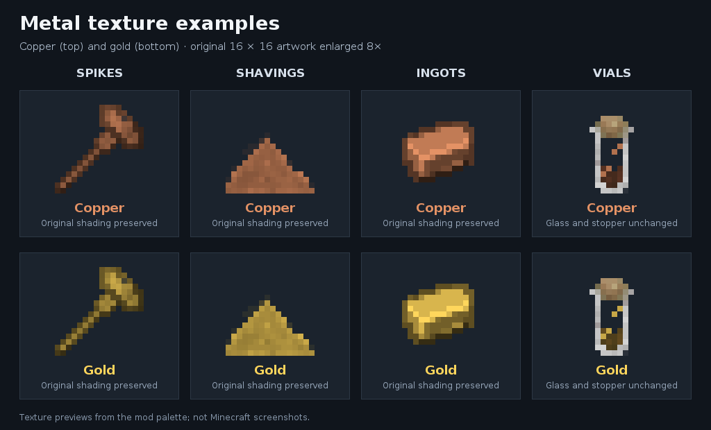

# Cosmere Arcanists
Minecraft **1.21.1**, NeoForge **21.1.256**, Java **21**. Author: **Ex**.

For current project status, accepted design decisions, verification and continuation notes, read [HANDOFF.md](HANDOFF.md). Development and handoff-maintenance instructions are in [AGENTS.md](AGENTS.md).

Current verification: changes through **0.51.0-alpha** are published on `main`. [CI run 40512130461](https://github.com/Exlor64/Cosmere-Arcanists/actions/runs/40512130461) for `a4cbde386ea9900d01482b21fef6287fb5db4acb` passed Java 21 builds/JUnit and all **323 required server GameTests**, both with and without Curios, plus standalone graphical client startup. Older release-note statements about unpublished changes or pending engine verification describe their original release sessions and are superseded by this result. Manual koloss model/weapon alignment, pack navigation and combat balance, Hemalurgy GUI/multiplayer behavior and regular-world Scadrial generation still need playtesting.

## Origins and assignment
- Persistent planet/race and natural Allomantic/Feruchemical power identifiers.
- Command-based Scadrial and separate Overworld origins; human race only so far.
- RANDOM (default), CHOICE, and ANCESTRY assignment modes.
- Per-art and per-metal switches, birth probabilities, Twinborn and reroll controls.
- Data survives death and relogging. Config changes do not reroll saved origins.
- Hemalurgy is acquired rather than a birth power. Melee extraction and the body implantation menu are implemented and published (0.50.0).

**Iron/steel/tin/pewter/electrum/atium/bronze/copper/zinc/brass/aluminum/duralumin/chromium/nicrosil/gold/bendalloy/cadmium Allomancy and the power selector are implemented. Scadrial is now a separate Overworld-style dimension with an independent seed. Other magic effects, planetary travel and the origin selection screen remain in development.** Scadrial will be Era 2 with an Overworld-like environment. The ancestry mode currently uses only a Scadrian-human probability multiplier; family inheritance and additional races are future work.

## Build and run
Install JDK 21 and import the root Gradle project into IntelliJ.

Windows: `./gradlew.bat build`, `./gradlew.bat runClient`, `./gradlew.bat runServer`.
Linux/macOS: `./gradlew build`, `./gradlew runClient`, `./gradlew runServer`.

Server settings are generated at `<world>/serverconfig/cosmerearcanists-server.toml`.
Use `defaultconfigs/cosmerearcanists-server.toml` to provide defaults for new worlds. Stop the server before editing config.

## Prototype commands
- `/cosmere origin scadrial` or `/cosmere origin overworld` in RANDOM/ANCESTRY modes.
- `/cosmere origin scadrial steel iron` in CHOICE mode (Allomancy first, Feruchemy second).
- Use `none` for either art in CHOICE mode.
- `/cosmere status` reports saved origin identifiers, including powers disabled by config.
- `/cosmere reset <player>` requires permission level 2 and clears an online player's origin.

Default birth chances are provisional: 25% for each natural art, independently. Each successful roll chooses uniformly among enabled metals. If Twinborn are disabled and both rolls succeed, one art is retained at random. A disabled art or empty metal pool produces no power. Origin selection does not teleport players yet.

## Development direction
1. Origin selection screen and expanded ancestry options.
2. Shared Investiture and ability access services respecting every relevant feature gate.
3. Remaining Allomancy, then metalminds/Feruchemy, then spikes/Hemalurgy.
4. Compounding and cross-system physics.
5. Scadrial terrain, Cognitive Realm, and perpendicularities.

Add behavior settings alongside each implemented feature; avoid presenting unused settings as working mechanics.

## Metallurgy (0.2.0)
Added tin, zinc, aluminum, chromium, cadmium, lead, silver, and nickel with raw materials, ingots, nuggets, and stone/deepslate ores. Vanilla iron, copper, and gold are reused; copper gains nuggets. All eight alloys have ingots/nuggets. Nicrosil is made from nickel and chromium only, as requested.

Alloy crafting uses coal for steel, tin/lead for pewter, copper/zinc for brass, copper/tin for bronze, aluminum/copper for duralumin, gold/silver for electrum, lead/tin/cadmium for bendalloy, and nickel/chromium for nicrosil. These are interim crafting batches, not canonical percentage recipes. Bismuth and silicon are not added.

Ores require an iron-tier pickaxe, support Silk Touch/Fortune, and smelt/blast into ingots. New ores generate in new Overworld chunks at Y -64 to 64 with six attempts per chunk and vein size seven. This is provisional balance. Adjust global/per-metal generation switches and vein acceptance probability in `config/cosmerearcanists-common.toml`; restart required. Per-alloy crafting switches are in the same file. Datapacks can modify vein size, height, attempt count, and all recipe ingredients/output quantities. Existing ores/items remain registered when generation or crafting is disabled.

The Cosmere Metals creative tab contains the new materials. Textures are initial distinct pixel palettes. `cosmerearcanists:metals` and `cosmerearcanists:aluminum_containing` item tags seed iron/steel detection. Duralumin is included in the aluminum exclusion tag.

## Iron/steel and power controls (0.3.0)
All sixteen ordinary Allomantic metals and atium-electrum alloy are implemented. All sixteen ordinary Feruchemical metals support item-owned storage/tapping, including nicrosil's permanent power transfers. Recent implementations remain pending full Minecraft verification; see HANDOFF.md.

Default keys (all rebindable):
- Hold **R**, scroll to a power, then release R to select it. Tap R to cycle that power's state. Left-click while the menu is open also cycles the highlighted power's state.
- Hold **V** and scroll to change state; release to apply. Tap V cycles state. Allomancy has Off/Low burn/Burning/Flaring; matching source-compatible Feruchemy unlocks backwards Compounding modes below Off (see 0.48.0). Feruchemy has Off and attribute-scaled storing/tapping levels (copper uses one level for each mode).
- Hold **Alternate Function** (default Left Alt) while pressing the drop key (default Q) to throw a single item, even with Ctrl held for sprinting. Ordinary Ctrl+Q still drops a full stack. This also works with rebound Alternate Function/drop keys.
- Hold **G** (Activate ability) to activate the currently selected implemented power. Iron/steel pull/push the metal source closest to your aim within the target cone while burning/flaring. Blue lines run from your chest to blocks, dropped items, and individual equipment sources. Lines are private to the Allomancer.

File metal into loose filings, then load up to 16 into a dynamic metal vial. Hold right-click to drink it like a potion. Each consumed filing adds 50 reserve of its metal; filings that cannot fit under the reserve cap (default 300 per metal) remain in the vial. Empty vials return a glass bottle. Low burn applies half force at half consumption; Burning costs one unit/second at normal force; Flaring triples consumption and doubles force. Sensing consumes reserves too. States/reserves are separate per metal; switching selected power does not turn off other burning metals. Death retains powers/reserves/selection but turns active states off.

Fixed blocks pull/push the player. Dropped stacks and equipped entities move under force, with player reaction and mass-dependent acceleration. Forces weaken with distance and have a configurable velocity cap. Armor sources affect the equipped entity, not a detached piece of equipment. Upward iron/steel force reduces accumulated fall distance in proportion to the reduction in squared downward speed. Arresting a descent can cancel its accumulated damage; a later unbraked descent adds fall distance normally. Sideways/downward force or merely burning metal grants no protection. This mitigation is configurable. Server-approved propulsion resets vanilla's floating timeout without granting creative flight.

Server-authoritative controls/physics settings: `<world>/serverconfig/cosmerearcanists-powers-server.toml`. Client HUD/line settings: `config/cosmerearcanists-client.toml`. Existing per-art/per-metal gates still apply. Settings cover range, force, flaring, reserves, reaction, player targets, target categories, scanner budget, and sync interval. Block checks are spread across ticks and do not load chunks.

Detection seeds use common metal tags plus `cosmerearcanists:metals`, then trace crafting/smithing/stonecutting recipes recursively. Furnace recycling is excluded from ingredient propagation. Aluminum anywhere in a recipe chain makes the result undetectable, even when another recipe avoids aluminum. This conservative treatment prevents aluminum bypasses. `cosmerearcanists:aluminum_containing` seeds exclusions and `cosmerearcanists:undetectable` directly excludes specific items. Unknown mod materials should supply common ingot/nugget/ore tags or the explicit seed tag. Dynamic/NBT-dependent recipes may need explicit tags.

Operator testing commands:
- `/cosmere power grant <player> a:iron`
- `/cosmere power grant <player> a:steel`
- `/cosmere power grant <player> f:iron` (selector test only)
- `/cosmere power revoke <player> <power>` sets the power’s base attribute to zero, including natural origin powers.
- `/cosmere power refill <player>` fills all ten implemented Allomantic reserves.

`./gradlew build` runs tests for recursive metal/aluminum classification, cyclic recipes, power states, and mass/distance/flaring force rules. CI also runs the GameTest server to validate runtime recipe detection and player data cloning. Multiplayer input, blue-line appearance, and hands-on movement still require client playtesting.

Activation uses START/TICK/STOP phases, allowing future instant abilities to act on press and held abilities to act continuously. Selection/state changes, release, disconnect, reload, death, and dimension changes stop the old handler. Unimplemented powers still show effects pending. The activation key's internal identifier is preserved so existing keybinds remain intact.

### Persistent power attributes

All 16 ordinary Allomantic and 16 Feruchemical powers have player attributes named
`cosmerearcanists:allomancy_<metal>` and `cosmerearcanists:feruchemy_<metal>`.
The atium–electrum alloy additionally has `cosmerearcanists:allomancy_atium`.
Zero means no power; 1 is normal strength. Positive effective values grant access,
and iron/steel force scales with the effective value (including attribute modifiers).
All ordinary Allomantic metals plus atium-electrum alloy have effects. Feruchemy currently implements iron, steel, pewter, gold, tin, brass, bronze, bendalloy, cadmium, copper, aluminum, zinc, electrum, duralumin and chromium; other Feruchemical powers have selection/state support only. Config switches gate access.

Operator examples:
```mcfunction
/attribute @s cosmerearcanists:allomancy_steel base set 1
/attribute @s cosmerearcanists:allomancy_steel base set 2
/attribute @s cosmerearcanists:allomancy_steel base set 0
/attribute @s cosmerearcanists:feruchemy_iron base set 1
```

Attributes persist through saving, reconnecting, death and dimension changes.
Respawning copies base values and permanent modifiers; burning/tapping states reset.
Old origins and operator grants migrate once. Origins describe initial ancestry;
attributes determine current powers. Grant sets at least normal strength; revoke
sets the base to zero. Modifiers can still grant a positive effective value.
Origin reset clears all power attributes and modifiers. Origin rerolls replace
the previous origin's base powers while preserving other attribute powers.

Metal block scanning publishes discoveries every tick, scanning a sphere from near to far. Moving does not restart an unfinished pass; teleporting beyond twice the radius does. The default snapshot interval is now 2 ticks (100 ms). Existing server configs retain their chosen interval; set `metalDetection.syncIntervalTicks = 2` for the faster cadence.

### Resistance and alternate steel movement

Solid blocks between the player's chest and a metal target add hardness-based
detection distance. The target itself and player voxel are excluded; air and
noncolliding blocks add no resistance. Defaults: 0.25 blocks of distance per
hardness point, capped at 50 per blocker (also used for unbreakable blocks).
For example, one obsidian blocker adds 12.5 blocks to the detection distance.
Disable or tune `metalDetection.blockResistance`, `resistanceDistancePerHardness`,
and `resistanceHardnessCap` in the powers server config. This gates both lines
and usable targets, including equipped gear and dropped items.

Hold **Left Alt** (Alternate power function) before pressing **G** with steel selected
and burning/flaring. While holding G, WASD requests horizontal movement relative
to player yaw, Space requests upward movement, and Shift requests downward movement.
The alternate mode latches at activation; release G before changing modes.
It shares the usual fuel, range, power strength, speed cap and fall braking rules.
Iron uses the same alternate controls to pull toward anchors in the requested direction.

Steel assistance uses up to four contributions from real detected metal anchors.
Each push follows the chest-to-metal line, with one combined force budget so dense
metal builds do not multiply power. Oblique anchors receive less force; anchors
more than 60 degrees off the requested direction cannot contribute, and a combined
force more than 45 degrees off is rejected. No movement input or suitable metal
means no assisted push. Set `ironSteel.alternateMovement = false` to disable it;
`movementAnchorAngleDegrees` tunes anchor acceptance. Equipped items on the same
entity share one anchor; entity recoil must be enabled to assist from loose gear/items.

Normal targeting now prefers the actual metal block hit by the crosshair, including
its edges. Forces still follow physical chest-to-metal directions, so an off-center
anchor can cause a diagonal push. Distance and target mass still influence force.
Player impulse calculations preserve observed movement on all three axes, since
server-side player delta motion does not retain horizontal client momentum.

Fast line discovery (0.5.1): each active tick refreshes a 6-block neighborhood at
the current player position. Falling or fast movement into a new block, and
starting activation, additionally scan up to 32768 near-first positions at the
current position (the full default 16-block sphere). All scans use loaded chunks
only and still apply hardness resistance. Configure `immediateScanRadius` and
`urgentBlockChecksPerTick` under `metalDetection`; reducing the urgent budget
reduces server work at the expense of distant anchor discovery during falls.
New or removed targets sync immediately even with an existing slower
`syncIntervalTicks`; periodic state/reserve updates now default to every tick.
Network latency and server tick rate still affect when lines reach the client.

0.5.2 fixes the horizontal-momentum regression introduced in 0.5.0. Horizontal and diagonal pushes/pulls now preserve observed momentum alongside vertical fall momentum.

0.5.3: player forces use an additive server-to-client impulse instead of replacing
client velocity with position displacement, preventing walking feedback while
preserving real inertia on all axes. Vanilla walking input opposing a recent
Allomantic impulse is removed, while perpendicular strafing remains available.
Disable that input rule with `ironSteel.preventWalkingAgainstForce = false`.
Actual momentum still takes force/time to reverse; this does not instantly stop
a player already moving toward an anchor. Input filtering expires after impulses
stop. Both client and server must update to this version (network protocol 2).

0.6.0: iron force now defaults to twice the previous strength, equivalent to the
old iron attribute value of 2 at a current attribute value of 1. The attribute
itself remains unchanged. Tune `ironSteel.ironStrengthMultiplier` (default 2).
This multiplier affects both aimed and assisted iron pulls and stacks with flaring.
Steel strength and reserve drain rates are unchanged. Range falloff still applies.

With iron selected and burning/flaring, hold Left Alt before G, then use WASD,
Space or Shift to pull toward suitable metals. Space requires overhead metal;
strafing left requires metal to the left. No suitable anchor means no force.
It shares steel's angle limits and single combined force budget. Disable iron
assistance separately with `ironSteel.ironAlternateMovement = false`.

0.6.1: Allomancy now has three active levels plus Off: Low burn (state 1),
Burning (2), Flaring (3). R tap/V tap cycle through all four states; hold V and
scroll to select a level. Applies to all Allomantic selectors; only implemented
powers currently have effects. Both aimed and alternate iron/steel use the levels.
Default force multipliers are 0.5/1/2 and consumption multipliers 0.5/1/3.
The iron base multiplier remains 2, so normal Burning at attribute 1 retains the
new iron baseline; Low burn deliberately provides a weaker pull.

Configure `lowBurnStrengthMultiplier`, `burningStrengthMultiplier`,
`flareStrengthMultiplier`, `lowBurnDrainMultiplier`, `burnDrainPerSecond`, and
`flareDrainMultiplier` under `ironSteel`. Existing saved Burning/Flaring states
migrate once to retain their meanings. Disabling flaring falls back to Burning.
Both client and server must update (network protocol 3).

### Steel projectiles (0.7.0)

While steel is selected and burning at any active level, hold **G** (Activate
ability) and throw a metal item with **Q**. It launches along your aim only while
the server has a fresh held-activation input. Burning alone, activating another
power, a brief released tap, and expired hold inputs leave ordinary drops.
Inventory drops also require that held activation; opening a GUI normally
releases activation.
With **Alt held before G**, Q fires boxings and clips straight down at your feet,
using normal shot fuel and recoil. Other metals drop as ordinary items without
projectile damage, launch recoil, or shot reserve cost. This uses the latched
alternate mode; release G before switching modes.
Nonmetal and aluminum-containing drops remain ordinary items. Steel must be
available/enabled, with enough reserves when consumption is enabled. The shot
uses normal power attributes and Low burn/Burning/Flaring multipliers.

Content is measured in nugget-equivalents: nugget 1, ingot 9, iron block 81,
anvil 279. Crafting/smithing/stonecutting ingredient counts and output counts
are traced recursively; nonmetal ingredients add no metal. Ingredient/recipe
alternatives use the smallest resolvable amount. Primitive raw metals/ores use
one ingot-equivalent as a balance approximation. Unresolved detectable items
use the configurable fallback. The entire thrown stack is one projectile.

At reference push force 7 a nugget launches at 3.5 blocks/tick and deals about 2 damage
before armor. Launch speed scales with effective push strength divided by the fourth root
of metal content. A baseline anvil launches at about 0.86 blocks/tick and gives
a substantial backward recoil, versus almost no recoil for a nugget.
Impact energy sets damage through an exponential saturation curve approaching
100; no hit can exceed 100 raw damage. Higher impact speed/power and more metal
increase damage smoothly. Armor and normal hurt immunity still apply.

Shots use swept projectile collision, have gravity/drag, and recover the exact
original stack on their first impact or after five seconds in flight. They do
not destroy terrain. Normal pickup delay applies. Player hits respect the
existing player-target toggle, team restrictions, and vanilla damage rules.

The `steelProjectiles` server config controls enablement, reference speed,
maximum speed, nugget damage, damage ceiling (at most 100), recoil mass, unknown
metal fallback, lifetime, and extra reserve cost per shot (default 1).
`ironSteel.reactionForce` also controls launch recoil. Update both sides for
the new projectile entity and renderer. Client appearance still needs in-game
verification; automated tests cover content, damage, collision and recovery.

0.7.1 corrects projectile activation: active steel pushing (G held, steel selected and burning) is required. Releasing G restores normal drops immediately on the server. Projectiles already fired continue their physical flight.

0.7.2: Alt+G+Q drops metal straight down rather than firing. Normal G+Q still shoots. `steelProjectiles.alternateDropDownwards` controls repositioning; disabling it retains ordinary vanilla drops during alternate mode, never projectile fire.

0.7.3: in-flight steel-launched metal is detectable, pushable and pullable by
other iron/steel Allomancers (and the shooter) through normal targeting or
alternate movement assistance. Blue lines follow the projectile center. Range,
hardness, aluminum exclusion, burn level, attributes, fuel and reaction-force
rules still apply. Configure `metalDetection.firedProjectiles` to disable this
interaction separately. Mass uses the actual carried metal content, so anvils
are harder to deflect than nuggets. Forces change existing flight velocity,
without creating a second projectile or replacing its original shooter/cargo.
Damage still depends on impact speed and remains capped at 100. Deflected
projectiles use the projectile speed cap rather than the player movement cap.

0.7.4: projectile launch velocity now scales **linearly** with effective steel
push strength (force setting × effective attribute × burn multiplier), rather
than its square root. At the original 0.7.4 defaults one nugget traveled 1.75 blocks/tick on
Low burn, 3.5 on Burning and 7 on Flaring at attribute 1. Attribute 2 doubles
those speeds until the configured projectile maxSpeed (default 8) is reached.
Heavy cargo still reduces speed. Recoil and impact damage follow the resulting
velocity; the damage ceiling remains 100. Existing in-flight push/pull also
uses effective Allomantic force and cargo mass.

### Two activation slots (0.8.0)

**G** activates the primary power; **H** activates the secondary power. Both
are rebindable and may be held together. Alt mode latches independently when
each activation starts. Each power still needs its own active state/reserves.

Hold R, scroll to highlight a power, and **right-click to switch its assignment
between primary and secondary**. Moving a power already assigned to the other
slot swaps them. Left-click still cycles its state. Releasing R after a
right-click preserves the assignment; ordinary scroll-and-release chooses
primary as before. HUD and menu show the actual bound key for each assignment.
V continues to change the primary power's state; use menu left-click to cycle
secondary's state. Assignments persist through respawn/save/reconnect.

Steel throws use whichever key has steel assigned: normal held G or H + Q
fires; Alt before that key + Q fires coins downward and drops other metal downward. The other key cannot authorize
a steel shot. Separate hold heartbeats/release and lifecycle cleanup apply.
Set `controls.secondaryActivation = false` to disable the secondary slot
without deleting its saved assignment. Both sides must update: protocol 4.

### Equipment (0.9.0)

- **Spikes:** two ingots of the same metal diagonally craft two spikes. There
  are 19 metal variants, including aluminum/duralumin (which Allomancy cannot
  detect). These are physical ammunition, not charged Hemalurgic spikes yet.
- **Spike crossbow:** craft a vanilla crossbow with two iron ingots. Load and
  fire like a normal crossbow, using spikes instead of arrows. Spikes stick
  into blocks, can be picked up nearby, and become iron/steel anchors.
- **Metal ball and rope:** craft one non-aluminum ingot with three string.
  Hold steel's assigned activation key while burning, then right-click to
  launch. Damage/speed use steel strength and metal content. Right-click
  again to reel it in for reuse. The weapon stays in inventory.
- **Grappling hook:** craft iron + tripwire hook + three string in the supplied
  shaped recipe. Right-click, charge and release (full charge in 10 ticks).
  It latches to solid blocks; swing on its rope, hold Space to shorten it
  slowly, or target it with Allomantic iron to pull yourself toward it.
  Right-click again recalls it. No Allomantic power is required for normal
  grapple use.

Equipment feature gates, range, return speed, grapple launch/charge, Space
shortening rate and spike damage/lifetime live in the equipment server config.
Tethers have one active head per inventory item; lost ownership/items end the
tether, and range overflow recalls it. Recipe choices beyond the user-specified
spikes and ball ingredients are provisional. Current icons reuse vanilla item
art; physical rope renders separately. Equipment initially used protocol5 and pewter protocol6; current bronze/copper release requires protocol9 on both sides.

Returning tether heads temporarily leave Allomantic targeting until reused, so holding steel does not fight recall. Spike ammunition currently does not implement arrow-only Piercing behavior.


### Steel strength (0.9.1)

Steel now defaults to twice its previous force, matching the iron boost. Attribute
1 now applies the former attribute 2 force at each burn level. Both aimed pushes
and Alt movement assistance use this boost; attributes, burn levels and range
falloff still scale force normally. Tune `ironSteel.steelStrengthMultiplier`
(default 2) in the powers server config; set it to 1 for the previous balance.
Reserve drain is unchanged.

Projectile and reusable ball launch speeds also follow the increased push
strength. At default steel attribute 1, a nugget launches at 3.5 blocks/tick on
Low burn, 7 on Burning and the configured cap of 8 on Flaring. Impact damage and
recoil follow actual velocity; the damage ceiling remains 100.


0.9.2: Alt can now be pressed immediately before activation, within the same
client tick; no extra tick of waiting is required. The alternate mode still
latches when G/H is pressed. Iron movement pulls toward metal in the requested
direction (Space needs overhead metal); steel pushes from metal opposite it.
Hold the activation key while changing WASD/Space/Shift. Release G/H to change
between normal and alternate use. Iron assistance must be enabled via
`ironSteel.ironAlternateMovement` in the powers server config.


### Allomantic pewter (0.10.0)

Grant with `/attribute @s cosmerearcanists:allomancy_pewter base set 1`, then
`/cosmere power refill @s`. Select pewter with R and use V to choose Low burn,
Burning, or Flaring. Pewter works passively while burning, with no G/H hold
required, even if another power is selected. Pewter filings can be loaded into the same dynamic vials as other metals (50 reserve per filing by default).

At attribute 1, Low/Burning/Flaring provide:

| Effect | Low burn | Burning | Flaring |
| --- | --- | --- | --- |
| Movement speed bonus | 10% | 20% | 40% |
| Melee damage bonus (health points) | 1.5 | 3 | 6 |
| Exhaustion prevented | 25% | 50% | 90% |
| Damage mitigation | 12.5% | 25% | 50% |
| Healing per 10 seconds (health points) | 0.5 | 1 | 2 |

Effects multiply by the effective pewter attribute. Mitigation is capped at 50%
for attributes <=1 and 70% for stronger attributes; speed, melee and endurance
also have configurable caps. The exhaustion reduction applies before vanilla
spends saturation or food, including sprinting, jumping, mining and attacking.

After armor, pewter mitigation and absorption, 10% of health damage is **deferred**
as pewter drag; the remaining 90% is taken immediately. For example, a 10-point
unarmored hit while Burning at attribute 1 deals 6.75 now and stores 0.75. A
separate row of gray hearts above the health/armor HUD shows this debt, with an
exact numeric amount (2 points = one heart). These hearts are not bonus health.

Stopping pewter, losing its attribute, or exhausting the reserve charges all
remaining debt once. This is already mitigated injury: the payout directly lowers
health, bypasses armor, absorption, invulnerability frames and totems, and can
kill. Debt persists across saves, relogging and dimension travel. Death clears it.

While burning and stationary on the ground or sleeping, each continuous 5-second
rest interval clears 1% of remaining debt per effective strength. Moving resets
the rest timer. Saturation also clears debt passively: default 0.2 saturation per
second per strength, clearing one damage point per saturation spent. It spends
nothing without debt and cannot spend more than needed. Healing, recovery,
bonuses and mitigation scale with burn strength; the deferred injury fraction
stays 10% across levels.

Tune/disable individual effects in `cosmerearcanists-pewter-server.toml`; zero
rates disable their effect. Disabling pewter, its per-metal/art gate, or drag
freezes saved debt rather than deleting or charging it. Re-enabling resumes
normal behavior. Client `pewterDragHearts` controls the debt HUD independently.
Reserve drain uses the shared burn-level consumption multipliers. Both client
and server must update (network protocol 6).


### Metal filing and mixed vials (0.11.0)

1. Craft a **Metal File** with an iron ingot above/right of a stick in a 2×2 grid.
2. Hold the file in your main hand and an ingot, nugget or metal storage block
   in your offhand. Right-click to produce one filing. One physical piece stays
   in your offhand; the untouched remainder of a stack returns to inventory.
3. Hold the filings in one hand and a glass bottle or metal vial in the other.
   Right-click the filings to load one. A glass bottle becomes a metal vial;
   alternatively craft an empty metal vial from one glass bottle.
4. Hold right-click on the vial for 32 ticks to drink. No reserves are granted
   if you release early. Each consumed filing restores 50 of its own metal's
   reserve. Empty vials return a glass bottle; excess filings remain in the vial
   when their metal reserve cannot fit the full 50. Put loose filings away from
   the other hand before drinking; that combination loads instead.

| Material | Total filings |
| --- | ---: |
| Nugget | 4 |
| Ingot | 36 |
| Metal storage block | 324 |

The file has 256 uses by default. Partially filed pieces become single items
with a durability bar and remaining-filings tooltip. They can be filed further,
but cannot be crafted, repaired/recycled through recipe machines, or placed as
blocks. This prevents turning a worn piece back into full material. Progress
persists through save/load and network synchronization. Full depletion consumes
the piece. The original item type and unrelated custom components are retained.

A vial holds **16 total filings**, freely mixed: 3 iron + 13 steel carries
150 iron reserve and 650 steel reserve. At the existing default cap of 300 per
metal, drinking that mixture leaves 7 steel filings in the vial. Raise
`ironSteel.reserveCapacity` if you want to ingest all 13 steel filings at once.
All 21 supported metals are fileable, including non-Allomantic alloy ingredients;
storing a reserve never grants a power or implements an unfinished effect.
Common tags support other mods' forms of these same metals. Ores/raw metal,
raw storage blocks, equipment, and arbitrary crafted metal items cannot be filed.

Any aluminum or duralumin filing makes the entire vial undetectable to
iron/steel. Loose filings and partial pieces also retain correct detection
and remaining-metal projectile mass.

Tune/disable the system in `cosmerearcanists-filings-server.toml`: filings per
nugget, vial capacity, reserve per filing, drink duration and file wear. Existing
partially filed pieces retain their original capacity. Disabling filing leaves
saved contents/progress intact and keeps worn metal excluded from recipes.
Old iron/steel/pewter vial IDs remain loadable and drinkable as one filing each
(50 reserve); their old bottle+nugget recipes are replaced by the filing workflow.
File/filing/vial icons currently reuse vanilla assets. Both client and server
need the update; protocol remains 6 (no payload changes).


### Allomantic tin (0.12.0)

Tin works passively while burning, even when another power is selected. Night
vision and held zoom work at lower levels. **Sound wireframes require high tin
strength**: at attribute 1, Low burn and Burning reveal nothing; Flaring gives
only a faint, brief glimpse of a small area. Higher attributes develop its
potential for the planned progression system. Reveals show the noisy entity's mesh, plus nearby exposed collision shapes such as
floors, walls, stairs and doors. Silent entities are not scanned or revealed merely
because they stand near a sound. Block-only noises reveal terrain, not a guessed
nearby mob. Echoes fade and remember the sound's location, not a continuously
tracked silent entity. Untracked entity models fall back to a source outline.

Hold tin's assigned activation key (G or H) for zoom. At attribute 1 Burning the
default is 2.5×; higher burn/attribute strength increases zoom up to 8×. Tin uses
the shared burn levels and drain multipliers, with base drain 1 reserve/sec.
Tin filings restore its reserve; `/cosmere power refill @s` includes tin.

**Sound blocking:** intervening collision geometry adds effective hearing
distance. Default per block is 2 + 0.75 × hardness (hardness capped at 10), with
12 additional distance for wool. More thickness/harder blocks muffle wireframes;
enough obstruction hides them completely. Attenuation reduces opacity, revealed
area, detail and persistence. This is a direct-path approximation, not acoustic
reflection/diffraction simulation. It affects tin's visual hearing effect; vanilla
audio playback is unchanged.

Effective strength is attribute × burn multiplier. The default wireframe unlock
threshold is 1.5; potential rises smoothly to full strength at 6 (attribute 3
Flaring). Baseline Flaring reaches 2, about 11% of full potential. Potential
reduces range, opacity, surface radius, detail and persistence. Higher attributes
can eventually reveal sound even without Flaring. The progression/XP system
itself is not implemented yet.

The base hearing range formula is 24 × sqrt(effective strength) × sqrt(volume),
capped at 64, then scaled from half to full range by wireframe potential. Base
surface radius is 3 (cap 6), and fade is 24 ticks (cap 60); potential and
obstruction further limit these. The server sends only validated,
bounded geometry from loaded chunks to active tin users in the same dimension.
Each listener has sound budgets/cooldowns; it is not a continuous X-ray scan.

Configure `cosmerearcanists-tin-server.toml` for enablement, sight/hearing/zoom,
unlock/full-strength thresholds, range, obstruction/hardness/wool costs, audibility cutoff, shape/network budgets,
fade and fuel drain. Client `tin` options control wireframe/model rendering,
opacity, line width, visible echo count and zoom. Tin now supplies graded lightmap vision; legacy tin potion effects
are cleaned up; independent potion effects are preserved. Sensory overload
is not included in this release.

Both client and server must update for **protocol 7**. Model wireframe appearance,
compatibility with third-party entity renderers, and in-game sound coverage still
need client playtesting. Some purely client-local/mod-specific sounds that do not
emit a server sound event cannot generate a server-authorized reveal.


### Atium and lerasium materials (0.13.0)

Added nuggets, ingots and placeable storage blocks for both **atium** and
**lerasium**, available in the mod creative tab. Conversions are reversible:
9 nuggets ↔ 1 ingot, and 9 ingots ↔ 1 block. Blocks require an iron-or-better
pickaxe and drop themselves. Both metals support filings (4/36/324 per form),
mixed vials, fifty reserve per filing, and iron/steel metal detection. Nugget,
ingot and block metal content remains 1/9/81 for projectile/recoil calculations.

Conversion recipes can be disabled globally or per metal under `godMetals` in
the metallurgy common config, followed by a recipe reload/restart. Items, placed
blocks and saved vial contents remain registered. Common ingot/nugget/storage
block tags support recipe compatibility. Current visuals reuse vanilla iron
for atium and gold for lerasium as temporary assets.

Natural acquisition/world generation and lerasium powers remain future work.
As of 0.14.0, existing atium IDs explicitly represent the atium–electrum alloy;
no pure-atium recipe, material, or effect is implied. No alloy ratio is invented.
The existing 32 ordinary Metallic Arts attributes remain; alloy Allomancy adds
one separate attribute. Current network protocol is 10; update both jars.


### Atium-alloy and electrum future sight (0.14.0)

Both work passively while burning, even when another power is selected. Atium
means the familiar **atium–electrum alloy**, including existing nuggets, ingots,
blocks, filings and reserve IDs. Old stacks/vials need no migration. There is
no pure-atium power or new alloy recipe; natural acquisition remains pending.

- **Atium:** silver-blue future silhouettes and paths for visible living entities,
  moving projectiles and dropped items. Threats are prioritized within the target
  budget. Likely projectile hits and aggressive mobs approaching melee range
  produce red warnings with ahead/behind/left/right labels, including threats
  outside the camera view. This is a mental aid, not automatic dodging or buffs.
- **Electrum:** gold silhouettes of your own projected movement, red for likely
  falls, lava/fire/contact hazards, projectile hits and possible nearby mob attacks.
  The attacker's identity/path is never sent for electrum alone. Hold its assigned
  G/H activation key while grounded to compare a hypothetical normal jump path.
  This previews an option without moving or jumping for you.
- An active atium or electrum burner causes another atium user's shadow of them
  to split into divergent purple possibilities. No precise central path or reliable
  hit warning is sent for that target. Possessing a dormant power is insufficient.

Use `/cosmere power grant @s a:atium` or `a:electrum`, then
`/cosmere power refill @s` and select a burn state. Atium uses persistent attribute
`cosmerearcanists:allomancy_atium`; electrum uses its existing attribute. The alloy
is deliberately outside the ordinary sixteen-metal origin/Feruchemy lists and is
currently granted by operators. No natural-origin probability silently changes.

Default horizon at attribute 1: Low 15, Burning 20, Flaring 25 ticks. Attribute
strength extends this modestly, capped at 40 ticks (two seconds). Baseline atium
range is 24 blocks, capped at 48. Updates are every 2 ticks, at most 12 targets
and 6 samples per shadow. Normal burn drains 4 atium or 1 electrum reserve/sec,
modified by shared burn consumption settings. Filings restore 50 as usual.

`cosmerearcanists-temporal-server.toml` controls each power, shadows, warnings,
interference, jump previews, projectile/attack forecasts, horizons, range, fuel,
update cadence and geometry budgets. Disabling preserves attributes/reserves.
Existing global/art/electrum gates apply; atium's per-metal gate is in this file.
Client `futureSight` controls paths, model silhouettes, warning HUD and opacity.

Forecasts extrapolate current movement and physics against loaded block collision
shapes. They cannot know future player inputs or fully simulate mob AI. Mob intent
warnings mean a possible attack, not a guaranteed scheduled strike. Jump previews
assume a normal .42 vertical launch, not every potion/mod/terrain combination.
No forced chunks, wall/invisibility detection, world slow-motion, extra damage,
or invulnerability. Models use the entity's current pose at future positions;
box outlines remain available if model rendering is disabled. Modded physics,
fluids, mounts and complex AI can diverge. Hands-on client/PvP rendering and
balance playtesting remain necessary. Both sides must update to protocol **8**.


### Bronze and copper (0.15.0)

Both work passively while burning, regardless of selected slot. Bronze senses
**active kinetic Investiture across Invested Arts**, not merely an attribute,
reserve inventory, stored metalmind, or an unimplemented power's selected state.
The eight implemented Allomantic powers now emit distinct rhythmic signals.
Other planetary arts are not implemented yet; a shared server API lets them and
compatible mods register providers or emit short-lived active-effect pulses.

Bronze gives private directional drumbeats and a pulse compass through walls.
Strength/burn state increase range and signal clarity. Normal strength can
identify ordinary Allomantic metals; harder foreign signals require more
strength. Low-strength unknown signals do not send their art/effect identity.
Hold bronze's assigned G/H activation key for up to three approximate distance,
height and identity readouts; stronger bronze can also recognize burn state.
No source UUID, player name, exact reserve count or entity outline is transmitted.
Unidentified source positions are coarsened to2-block cells; identified ones to
half-block cells. Rhythm and pitch values are provisional gameplay choices.

Copper creates an invisible field around the burner, hiding compatible signals
inside it. A Seeker standing inside a cloud also loses signals originating
outside it. Multiple Smokers' fields add strength; the same field counts only
once even when both listener and source are inside it. Intermediate clouds are
not treated as solid ray barriers. Sufficiently strong bronze can pierce weaker
clouds, receiving an attenuated signal. Copper does not disable others' powers,
block damage, hide bodies, or remove ordinary sounds.

Emotional protection applies to the **copper burner alone**, via the shared
`EmotionalInfluenceEvent.allowed(target,strength)` server integration point.
Emotional Allomancy pierces only at **at least1.25 times** the burner's copper
strength by default. Strength is attribute times burn multiplier, before distance
falloff. This protects against all five emotions and minion control; increasing
copper strength can remove existing influence/control. Third-party emotional
powers must call this API to respect protection. No unrelated vanilla potion, AI or damage effects are canceled.

Default normal-burn reserve costs: bronze .5/sec, copper .25/sec, multiplied by
shared burn-consumption settings. Bronze range24, cap64; copper radius12, cap32;
each scales with square-root strength. Bronze must exceed combined copper
strength ×3 to pierce. Copper blocks incoming emotional strength below1.25 times its strength;
exact equality at that threshold pierces.
Ordinary effect identification threshold1; burn-state detail threshold2, divided
by the signal's detection difficulty. Bronze settings remain separate from the emotional protection rule.

Configure `cosmerearcanists-seeking-server.toml` for global/per-power enablement,
fuel, detection, other arts, identification, held focus, copper masking, emotional
protection/piercing, ranges, thresholds, scan cadence and budgets. Defaults scan
once per4ticks, at most32 detected pulses and1024 collected emissions per
dimension. Disabling preserves attributes/reserves. Client `seeking` options
control pulse/copper HUD, private rhythms/volume and displayed pulse budget.
Per user request, pulses use Minecraft note-block sounds. Client `pulseInstrument`
selects BASS_DRUM (default), BASS, HARP, SNARE, HAT, BELL, CHIME or FLUTE;
effect-specific rhythms and pitches remain. No custom sound pack is required.

Integration API: `investiture.InvestitureSignals.register(id,provider)` reports
active signals on collection; `emit(level,signal,lifetimeTicks)` reports one-shot
use for1..100ticks. Signals carry art/effect IDs, stable source UUID, loaded
position, intensity, difficulty, period, optional burn state and copper-maskable
flag. A source/art/effect has one refreshed signal, not an accumulating trail.
Providers must not load chunks and should report only real kinetic activity;
external systems can opt out of copper masking when their lore requires it.

Use `/cosmere power grant @s a:bronze` or `a:copper`, then
`/cosmere power refill @s`; both reuse existing persistent attributes, filings
and mixed vials. Toggle their burn state in the existing menu. Registry and save
IDs are unchanged. Update client and server together: protocol **9**.

Automated checks cover active-only emissions, foreign providers, concealment,
piercing/stacking, private unknown identities, personal emotional protection,
fuel/disablement/respawn, pulse expiry/focus, budgets and packet round trips.
Actual positional audio, HUD appearance and multiplayer balance need manual
playtesting. Progression XP/savantism and other arts are still future work.


### Emotional Allomancy: zinc and brass (0.16.1)

Zinc intensifies and brass suppresses one of five emotions: **anger, fear, trust,
love, compliance**. Most mobs respond; animals receive half the influence by
default. The highest emotional level determines behavior, with stable enum order
breaking ties. Opposing Rioting/Soothing and multiple users combine rather than
stacking repeated packets from the same user into unlimited power.

Hold the assigned G/H activation key to influence the aimed target. Hold that key
and scroll to select an emotion; R/V menu scrolling retains priority. Hold Alt
before activation for bounded area influence. Selection is stored separately for
zinc/brass and survives respawn/relog. Burning drains1 reserve/sec at normal burn,
with existing low/flare multipliers; passive burning alone does not influence
others. Both powers produce bronze-detectable signals while burning.

- **Anger:** mobs attack nearby mobs, including passive animals using a small
  fallback attack. Players gain about25% melee attack damage per effective
  strength, capped75%.
- **Fear:** mobs flee the influencing user. Players receive a40tick speed burst
  on fear onset and30% lower melee attack damage and attack speed per strength.
  The burst cannot retrigger within100ticks; reductions cap90%.
- **Trust:** animals' avoidance of the influencing user and non-fire injury panic
  are suppressed; villagers' injury/avoidance memories are calmed. Trust lowers
  the influencing user's villager prices by15% per strength, max50%, at trading
  session start. Vanilla resets session prices afterward; base prices and gossip
  are not changed. An already open trading session keeps its quoted prices.
- **Love:** adult breeding-ready animals enter vanilla love mode; babies and
  cooldowns are respected. Willing love-influenced villagers receive mate intent,
  retaining vanilla food/bed checks. Influenced players deal less damage to the
  influencing user only:12.5% per strength means25% at baseline Flaring, cap75%.
- **Compliance:** mobs slowly follow the user. Players receive a weak horizontal
  additive pull every4ticks, .003 per strength capped.02, retaining their input
  and existing momentum. No teleporting or forced look direction.

Effect strength scales with persistent power attributes, burn level, distance and
animal multiplier. Natural baseline emotions and current combat intent seed the
state. Influence fades over80ticks after application; stronger new emotions can
replace the dominant behavior. Only the winning emotion applies its mechanics.

Copper's existing emotional-influence gateway can block actual zinc/brass use.
Aluminum-containing headwear (recursive recipe classification) and items in
`cosmerearcanists:emotion_shielding` also protect. Default entity-type tag
`cosmerearcanists:emotionally_immune` excludes dragon/wither/armor stands; datapacks
can change it. Disabling a power/effect removes its active influence/modifiers
while retaining player attributes, reserves and emotion selections.

`cosmerearcanists-emotions-server.toml` exposes power/entity/animal/area toggles,
per-emotion and breeding/trade toggles, drains, ranges, animal response, duration,
target/state budgets, combat rates, burst timings, discounts and compliance force.
Defaults range16sqrt(strength), cap32,16 targets/use,256 affected entities. Native
pathfinding is requested only inside a verified loaded region; custom mob AI
compatibility and terrain navigation still require playtesting. Client
`emotionControlsAndStatus` toggles the emotion selector/status HUD.

Test with `/cosmere power grant @s a:zinc`, `a:brass`, then
`/cosmere power refill @s`. Existing persistent attributes and mixed vials work;
no new registry IDs or save migration. Client and server need protocol **15**.
The private emotional status packet does not disclose an influencing player's
identity. Player emotional mechanics and species behavior are gameplay choices
requested for this mod; progression XP and Hemalurgy equipment remain future.

Soothing anger with brass can pacify naturally hostile mobs when anger loses
dominance, clearing their current attack target and preventing reacquisition
while the suppression lasts. Weak Soothing that leaves anger strongest preserves
ordinary hostility. Lowering another emotion can expose anger in a passive mob.
Losing love ends breeding readiness; calmed creepers stop autonomous swelling,
although deliberate ignition still works.

### Overwhelming compliance and minions (0.17.0)

Dominant positive compliance can seize a damaged spirit. Defaults require effective
compliance strength4 and spiritual integrity at most0.5 (intact spirits default1).
At threshold the target becomes a minion for60seconds; duration scales linearly
with effective strength, capped at10minutes. Continued application refreshes it.
Mob minions follow their controller and assist recent combat. Controlled players
receive forced horizontal following and automatic visible, in-range melee attacks,
while retaining their camera and inventory controls. Minions cannot hurt their
controller or fellow minions. Control ends on expiry, death, logout, dimension
change, restored integrity, protective copper/aluminum, or disabling the feature.
Stronger compliance can replace an existing controller.

Tune `domination` in the server emotions config. Operators can test spiritual
damage with `/cosmere integrity <targets> <value>` (0..1), grant zinc, increase
`cosmerearcanists:allomancy_zinc` with vanilla `/attribute`, refill, and apply
compliance. Spiritual integrity persists through saves and player respawns;
control does not survive restart. Hemalurgy spike effects remain future work; duralumin is implemented below.

Copper emotional protection uses `copper.minimumEmotionalStrengthRatio` (default
1.25) in the seeking server config, replacing the old `emotionalPiercingRatio`
key so existing default4 settings do not override the new rule. Disabling
emotional piercing makes active copper fully protective. An attack's sampled
metal strength is retained during its linger/control duration; copper protection
is rechecked against the defender's current active strength.

### Aluminum and duralumin (0.18.0)

Enable their burn state with the existing power controls; neither requires holding
G/H. Aluminum immediately empties all personal metal reserves and stops burning.
It also posts `InvestitureCleanseEvent` so future worlds can remove their own
foreign Investiture influences. Ordinary potion effects, powers and spiritual
integrity are preserved.

At duralumin attribute1:

| Duralumin state | Other active power strength | Metal consumption |
|---|---|---|
| Low burn |1.75x|5x normal burn rate|
| Burning |2.5x|10x normal burn rate|
| Flaring |5x|Captured reserves consumed over their flare window|

Each already-burning metal gets `5 seconds * current reserves / max reserves`
of flare time: full reserves5seconds, half2.5seconds. Each has its own timer.
The flare commits its captured fuel even if toggled off; new metals do not join
mid-burst. Additional fuel does not extend the timer. Duralumin consumes its own
captured reserve over the longest window. Powers stop at their window end.

Higher duralumin attributes chiefly improve efficiency. Per attribute doubling,
the bonus strength grows10percent and efficiency grows50percent. Attribute2
gives low-burn1.825x power at5/1.5x drain, or flare5.4x with a full-reserve
window7.5seconds. Both curves are configurable. Low/normal drain never falls
below ordinary consumption. Boosts apply to existing Allomantic effects without
changing saved attributes; their existing effect caps remain in force.

Configure `cosmerearcanists-enhancement-server.toml` for feature gates, purge and
cleansing behavior, multipliers, durations, own-metal drain and attribute curves.
Future Invested Arts can query `EnhancementService.profile(player)` for a
resource-independent boost profile and apply its duration to their own budgets;
those integrations are still future work. Existing vials support both metals.
Use `/cosmere power grant @s a:aluminum` or `a:duralumin`, then refill.

### Pewter HUD and Tin visibility (0.18.1)

Pewter's gray debt hearts sit immediately above the health stack, or above armor
when present, without the "Pewter drag" text. Extra health and absorption rows
are included in the layout.

Tin's server-approved sound echoes draw through blocks for both model wireframes
and block/source outlines. The renderer explicitly bypasses inherited world
depth testing and restores it after drawing. High-strength requirements and
sound obstruction still apply: thick/hard barriers or wool can mute or entirely
suppress a reveal. This does not continuously reveal silent mobs.

### Clearer Tin echoes (0.18.2)

Sound echoes last40percent longer by default, hold their brightness briefly, then
fade more gently. Wireframes use brighter pale cyan,35percent greater opacity
and25percent wider lines. Strength and sound obstruction still limit visibility.
Tune server `hearing.echoPersistenceMultiplier` and client
`tin.echoBrightnessMultiplier`, `tin.echoLineWidthMultiplier`, and
`tin.echoHoldFraction`. They multiply existing lifetime/opacity/width settings,
so existing installations receive the improvement without resetting preferences.

### Tin wave pulses (0.19.0)

Tin wireframes now require **Flaring** by default, even at very high attributes.
Night vision and zoom still work during ordinary burning. Approved sounds launch
expanding rings and reveal nearby surfaces progressively as the wave reaches
them. Mob outlines use smoothly interpolated movement during their short echo
window; silent mobs disappear when that window expires.

Pulse visual intensity and hearing/reveal ranges are doubled; opacity remains
capped and sound blocking still applies. Tune client `tin.pulseIntensityMultiplier` and
`tin.waveSpeed`, or server `hearing.wireframesRequireFlaring` and
`hearing.echoRangeMultiplier`. Default hearing base/cap becomes48/128blocks,
and surface radius/cap becomes6/12blocks before strength/attenuation scaling. Existing echo
duration/brightness/width settings still apply. Client and server must both
update: networking protocol is now **11** for authoritative wireframe eligibility.

### Held, subtler future sight (0.20.0)

Atium and electrum now require holding their assigned **G/H** activation button
in addition to burning. Release clears the forecast and stops normal drain and
future-sight interference. Existing duralumin burst fuel commitments still apply.
Shadows are subtler, use fewer ghost models, and no longer have box outlines.
Tune client `futureSight.prominenceMultiplier` (default0.45) or server
`requireHeldActivation`.

Electrum can mark a future self with **may draw hostile attention** if that path
enters a nearby idle hostile mob's targeting range and predicted line of sight.
This also applies to the jump preview. It reveals no attacker identity/path and
does not change actual mob AI. The bounded forecast approximates ordinary mob
aggro; special senses, equipment rules and custom AI may differ. Toggle server
`electrumAggroWarnings`. Both client and server need protocol **15**.

### Emotional targeting and power-panel layout (0.21.0)

While **burning zinc or brass**, nearby visible mobs and players show their
current dominant emotion above their heads. No aiming, activation hold, or slot
assignment is needed. Stopping both metals or running out of fuel removes the
readout. Labels reflect the mod's emotional model, including natural baseline
and manipulated states; they respect walls, range, copper and aluminum
protections. Server and client `targetEmotionIndicator` can each disable them.
The private readout updates every four ticks and is bounded to the nearest 256
eligible targets within the configured emotional range.

The selected emotion now appears at the bottom-right of each blue power panel,
next to the reserve/burn information. Detached pink mode text is removed;
ability+scroll still changes emotion.

In `cosmerearcanists-client.toml`:

- `hidePowerIndicator = true` hides the **entire blue primary/secondary group**.
- `hudX` / `hudY` move it; `-1` uses the default edge anchor.
- `hudScale` resizes the entire group, including its text, icons and background
  (default1;0.25–3). Oversized groups fit the viewport.

The legacy `selectedPowerIcon` toggle is also respected. Selection menus and
the mob emotion indicator remain independent. Update client and server together
for protocol **15**.

### Atium flare dodge (0.22.0)

Flaring the atium-electrum alloy grants a **10% dodge chance** against melee and
physical projectile hits while its future sight is active (hold the assigned
activation button by default). Chance scales with the square root of effective
strength relative to baseline flaring, capped at **25%**. Duralumin contributes
to effective strength. Normal/low burning grants no dodge. Successful dodges
cancel the hit before armor/pewter damage processing, without teleporting you.
Falls, fire, lava, explosions and armor/invulnerability-bypassing damage are
excluded. Attackers actively using atium/electrum counter the dodge when
`futureSightInterference` is enabled.

In `cosmerearcanists-temporal-server.toml`, `atiumDodge.enabled`,
`atiumDodge.baseChance` and `atiumDodge.maxChance` control the feature. Existing
future-sight activation, fuel, flaring and global power gates apply. No save or
network migration; protocol remains **14**.

### Alternate temporal powers (0.23.0)

While **flaring electrum**, hold its activation button and **Alt** to scout as a
private electrum shadow. WASD moves the shadow, Space jumps, and crouch slows it.
Your real body remains stationary and vulnerable. Start while grounded; the
shadow respects solid blocks and loaded chunks. You cannot attack, use items,
interact with blocks or activate other targeted powers while scouting. Damage,
fuel depletion, releasing Alt/activation, death, dimension changes and logout
end scouting. Damage interrupts require releasing Alt before starting again.

Range is **8 blocks at baseline flaring strength**, scaling with the square root
of effective electrum power, including duralumin (attribute4 normally gives16
blocks). Default cap32 blocks. Configure `electrumScout.enabled`, `baseRange`,
`maxRange` and `movementPerTick` in the temporal server config. This is a private
future viewpoint; it does not create an interacting second player or spectator
body. Third-person view shows the golden projection; first person views through
its eyes.

Atium's **Alt + activation** shows three possible forecasts per visible entity.
The current-motion forecast is brighter; two alternative turns are dimmer. These
are short conditional predictions, not certainty about a player's future inputs.
An interfering atium/electrum user instead gives three equally uncertain paths,
without revealing a privileged true path. `atiumAlternateShadows` disables the
extra paths. Alt can be pressed/released while either temporal activation is held;
other powers retain their existing Alt latch behavior. Both sides need protocol
**15**. No persistent player-data migration.

### Graded tin vision (0.24.0)

Tin brightens Minecraft's lightmap according to **effective strength**, including
burn level, attributes and duralumin. It no longer grants a fixed night-vision
potion. Default enhancement is approximately **25% low burning, 43% burning and
66% flaring** at attribute1, smoothly approaching95% at very high power. These
percentages describe the lightmap lift toward full brightness, not a vision range.
Already bright areas change less; actual world/block light levels stay unchanged.
Ordinary night-vision potions retain their full vanilla effect.

In `cosmerearcanists-tin-server.toml`, existing `nightVision` toggles the feature;
`vision.strengthResponse` (default0.6) controls the curve and
`vision.maxBrightness` (default0.95) sets its ceiling. In the client config,
`tin.variableNightVision`, `tin.visionBrightnessMultiplier` and
`tin.visionTransitionTicks` control display and the smooth transition. Old
tin-owned hidden potion effects are cleaned up; other potions are preserved.
Client and server need protocol **16**. This uses the vanilla lightmap sampled by
world shaders; shader packs replacing that pipeline need separate compatibility
testing. Tin's hearing, flaring-only echoes and held zoom are unchanged.

### Soft white tin echoes (0.24.1)

Tin's sound impressions now default to **faint, soft white blurs**, replacing the
hard block and mob wireframes. A small Gaussian shader feathers each impression
to transparency; the world itself remains sharp. Echoes still travel outward
from sounds, fade, follow sounding mobs and remain visible through walls when
server-approved. Flaring/strength thresholds and sound obstruction are unchanged.

In the client config `[tin]`, set `echoStyle = "WIREFRAME"` to restore the previous
look, or keep `"SOFT_BLUR"`. `blurOpacity` defaults0.16, `blurSize` defaults1, and
`maxBlurPuffs` defaults64 per frame. Surface impressions are merged across
overlapping sounds, opacity is reduced during multiple echoes, and clouds very
near the camera are skipped to keep vision clear. Existing echo visibility
controls still apply. No protocol or saved-data changes (protocol16).

### Readable soft tin silhouettes (0.24.2)

The soft echo style now includes recognizable **white mob silhouettes** and
**terrain contours through walls**, with a faint filled surface and soft halo.
The Gaussian clouds remain a subtle backdrop. Strong tin reaches45% mob/contour
opacity by default; multiple sounds no longer dim these shapes. Baseline flaring
still provides a weaker glimpse, and obstruction/fade/strength gating still apply.

Existing `echoStyle = "SOFT_BLUR"` automatically uses the improved rendering,
including previously saved low `blurOpacity` settings. New client settings
`tin.softMobOpacity`, `tin.softTerrainOpacity`, `tin.softTerrainFillOpacity` and
`tin.maxSoftSurfaces` control the readable shapes independently of cloud opacity.
Repeated surface shapes and mob sources are merged; up to256 exact surface
shapes are displayed per frame. `WIREFRAME` remains available. Protocol16 and
saved data are unchanged.

### Mob navigation forecasts (0.25.0)

Atium's brighter mob shadow now follows the mob's **current AI navigation route**
around corners and stops at its path destination. It uses observed movement
speed, or the requested navigation speed and movement attribute when starting
from rest. The two alternate shadows diverge from that predicted heading. Mob
attack/proximity warnings also use the improved movement forecast; electrum
continues to send only the observer's own future.

Only a bounded, read-only snapshot of an existing ground-navigation route is
used. Forecasting never runs AI, advances path nodes, computes a new path, or
loads chunks. Collision, gravity and short upward-node jump approximations still
apply. Players, projectiles, airborne/swimming/flying mobs, missing paths and
recent hits and strong/opposing knockback retain movement forecasts. Intent can change, so the
existing frequent updates remain important. No exact future input is known.

Temporal server config: `mobNavigationPredictions` (defaulttrue) restores motion
forecasts when disabled; `maxPredictionPathNodes` (default64) bounds copied
waypoints. Existing target, time and loaded-geometry limits remain. No packet or
save changes; protocol16.

### Anger preserves native mob attacks (0.25.1)

Anger now switches combat-capable mobs' aggro to the **nearest valid mob** without
replacing their normal attacks. Skeletons retain bows, crossbow users retain
crossbows, and melee/special combat uses native AI. A separate target-only anger
goal leaves movement and aiming available to attack goals. Brain-based attackers
also receive the selected attack-target memory; native memory resets cannot
discard that selection while anger is controlling the target. Friendly/allied, dead and
otherwise invalid targets are excluded; players are not selected by mob anger.

Normally passive mobs retain the fallback chase/melee behavior. Fear, compliance
and domination behavior is unchanged. In the emotions server config,
`effects.angerPreservesNativeAttacks` defaults true and
`effects.angerTargetRange` defaults16 blocks (configurable1–64). Disabling native
attack preservation restores the old forced combat behavior. Temporary anger
targets clear when the target-only goal ends; normal targeting can resume.
No save/network changes (protocol16).


### Chromium and nicrosil (0.26.0)

Burn the selected metal, aim at a living target within **3 blocks**, and hold its
activation key (**G** for primary or **H** for secondary). Contact is checked on
the server and requires an unobstructed ray to the nearest body. Creative and
spectator targets are protected; server PvP and team friendly-fire rules apply
by default. Ordinary mobs currently have no metal reserves to affect.

- **Chromium** empties the target's stored metal reserves, ends their Allomantic
  burns, and cancels active duralumin/nicrosil bursts. It preserves permanent
  power attributes, Feruchemy states, spiritual integrity, and ordinary potions.
- **Nicrosil** commits the target's currently burning implemented metals to a
  finite burst. At attribute1, low burn gives **1.75x**, burning **2.5x**, and
  flaring **5x** effective strength. Each metal spends its captured reserves over
  **100 ticks × current/max reserves**. Higher nicrosil strength primarily
  improves duration/efficiency with a smaller increase in peak strength.
  Stopping a burn does not evade its committed fuel cost; refills are preserved
  beyond that cost and do not extend it. Repeated touches cannot refresh an
  existing commitment. Aluminum, duralumin, chromium, and nicrosil are excluded
  from the recipient burst to avoid enhancer loops. Duralumin and nicrosil use
  the stronger effect rather than multiplying together.

Successful contacts cost **10 reserve**, scale down with effective strength,
and have a **20-tick cooldown** per source and metal. Burning either contact
metal also consumes **1 reserve/second**, scaled by burn level and duralumin.
Misses and contacts with no eligible effect have no extra contact cost.

`<world>/serverconfig/cosmerearcanists-contact-server.toml` controls both powers,
range, player/mob targeting, PvP rules, cost, cooldown, consumption, nicrosil
multipliers/duration/scaling, messages, and foreign-art hooks. Disabling a
feature clears its transient boost while preserving saved attributes and
unspent reserves. Bursts also end on death, logout, dimension change, or restart.
The cancellable `InvestitureContactEvent` lets later invested arts queue their
own resource effects after validation; nicrosil integrations must snapshot and
spend their own finite fuel budgets. Chromium does not generically remove
external influences as aluminum does.

All sixteen ordinary Allomantic metals now have implemented effects.
Pure-atium and lerasium powers remain future work.


### Gold: character version history (0.27.0)

Burn gold and hold its assigned **G/H** activation key to see a private golden
past-self beside you. **Alt + Activate** selects an older recorded version once
per press; release and press again to cycle. This is the chosen game adaptation
of gold's personal-past theme, rather than alternate-action prediction.

The vision uses your current player model and the equipment types you wore in that
version. Labels show its age, experience level, origin, power strengths, and
spiritual integrity. Equipment components, enchantments, dyes, item contents,
and historical skins are not recorded. The display never restores items,
experience, health, powers or spiritual integrity. It cannot scout or simulate
alternate fights, and it does not load your former surroundings.

Recording starts for all players, including those without gold, so later Augurs
can see their earlier versions. Only post-install history exists. The initial
state is saved, meaningful descriptive changes may save after a one-minute
cooldown, and a five-minute periodic deadline can capture a pending change if a longer
cooldown is configured. Identical periodic copies are disabled by default.
Checks run every40ticks. History retains the first recorded self plus the newest15 later versions and
survives logout, restart and respawn. Older later entries expire at the configured cap; the first self is retained
by default. Both first-record retention and unchanged periodic copies are configurable.
There are no position histories or saved inventories. The initial record can
represent your current self until another version has been captured.

Baseline low/burning/flaring strengths expose2/4/5 recent versions respectively;
stronger effective gold increases access up to the retention cap and makes the
vision clearer. Default fuel use is1reserve/second at Burning, with common burn
and enhancement modifiers. Duralumin/nicrosil enhance gold normally and bronze
can detect its active burning. Views end on release, empty reserves, death,
spectator mode, dimension change or feature disable; saved history is preserved.

`cosmerearcanists-gold-server.toml` controls the feature, recording, retention,
snapshot cooldown/period, equipment/details, activation requirement, accessible
history, shadow distance, updates, and fuel use. Client `gold.historyShadow`,
`historyLabels` and `opacityMultiplier` control presentation independently.
Network protocol17 requires matching mod versions on client and server.


### Anchored temporal bubbles (0.28.0)

This follows the requested gameplay mapping: **bendalloy slows others inside**;
**cadmium speeds others inside**. Burn the metal and **hold its G/H activation
key** to create a sphere at your current body center. The center stays fixed.
You move normally inside your own sphere. **Release the key, leave its radius,
stop burning, or exhaust the metal and the bubble collapses.** Death, logout,
spectator mode, dimension changes and disabled features also remove bubbles.
Returning to the old center does not restore one; activate again to create it.

At attribute1, low/burning/flaring time rates for bendalloy are2/3,1/2,1/3;
for cadmium they are1.5x,2x,3x. Radius is4blocks times the square root of effective
strength, capped at16. Default minimum time rate is1/8; acceleration is capped at4x.
Burn levels, attributes and duralumin/nicrosil affect both strength and radius;
changes keep the original center. Burning uses2reserve/second at Burning with
common burn/enhancement modifiers. Existing vials, refill, selection and bronze
signals support both metals.

Nearby players see a **shimmering translucent sphere**: blue for bendalloy,
amber for cadmium. Animated ripples and moving brightness bands mark the shell
from inside and outside without an opaque screen. Client `timeBubbles` settings
control visibility, opacity, ripple size, sphere detail and visible-sphere limit.
Normal depth testing lets terrain obscure parts of the boundary.

Crossing either boundary adds a random deviation within a4degree cone by
default, preserving speed. Swept tests detect both crossings when a fast entity
passes completely through a sphere between updates. The owner and their mount
group are exempt from their own sphere. Other player effects respect PvP and
team protections by default; creative/spectator players are excluded.

Mobs, items, TNT and other non-player entities receive fractional or additional
logical ticks. Slowed entities still take movement steps every server frame;
projectiles continue raycasting on skipped logic frames. Client projectile
prediction uses matching time steps while remote mobs keep ordinary interpolation. Native projectile
physics and mod-specific behavior can introduce approximation, particularly for
custom accelerating projectiles and passenger physics. Steel-shot damage uses
intrinsic velocity so a temporary movement subdivision does not change its
metal/launch damage calculation. Ticking block entities such as furnaces also
use local time. As of0.28.1, random block/fluid updates and scheduled block/fluid/redstone
delays also follow local bubble time. Global daylight and weather remain shared.

Other players keep normal network/input ticks; their movement, gravity, attack
cooldown, mining, item use, base vital/effect timers and hunger timers are scaled
separately. Menus, power fuel/burst windows, and independent mod timers keep server time.
Boundary response is evaluated at entity movement updates rather than a fully
continuous physics simulation.
Movement changes ease over several ticks, with a soft transition just inside
the sphere boundary. Overlapping time factors multiply within configured caps;
own-bubble exemption applies individually. No forced chunk loading or saved
bubble entities are used; bubbles are transient and never survive a restart.

`cosmerearcanists-bubbles-server.toml` controls feature/metal switches, affected
entities/players/block entities/player vitals, PvP, strength/radius caps, fuel,
transition/boundary blending, deflection, update frequency and work limits.
Network protocol18 requires matching client/server versions.


### Temporal bubbles affect world updates (0.28.1)

Bubbles affect **mobs, animals, dropped items, projectiles, TNT, ticking machines,
other players, random growth/decay/fire updates, scheduled fluids, and scheduled
redstone/block updates**. The caster remains exempt from their own time effect.
Existing hold/release, fixed position, exit collapse, shimmer and boundary
trajectory deviation rules are unchanged.

Scheduled updates use a local remaining-delay budget, including updates queued
before a bubble appeared. Acceleration can advance short scheduled chains more
than once per server frame. Tick type, position, priority, ordering and duplicate
protection are preserved. On collapse, the remaining adjusted delay continues in
the vanilla queue; pending updates are not discarded. Only already registered
chunk queues are inspected. No chunks are loaded to accelerate distant systems.

Random updates use the local rate to determine how many native random callbacks
run, reading the current block/fluid state after each step. This covers growth,
leaf decay and similar processes without ticking a stale state repeatedly.
Growth remains random rather than guaranteed. Immediate neighbor notifications
remain synchronous; timed redstone delays and ticking piston machines use local
time. Global day/weather and independent timers outside the world's usual tick
systems are not separate clocks for each region.

New bubble-server switches: `affectRandomBlockTicks`, `affectRandomFluidTicks`,
`affectScheduledBlockTicks`, `affectScheduledFluidTicks`. A configurable
`maximumScheduledEntriesProcessedPerWorldTick` bounds extra work (default16384);
entries beyond that per-frame processing limit retain ordinary scheduling.
Protocol remains18; matching0.28.1 client/server installs are recommended.

### Dropped-item bubble prediction (0.28.2)

Dropped items now simulate bubble time on the client as well as the server,
preventing normal-speed falling followed by repeated upward corrections. Both
slowing and acceleration use the shared entity clock. Protocol remains18.

### Iron and steel range scaling (0.28.3)

At attribute1, low burning reaches9.6 blocks, burning12.8, and flaring16.
Attribute2 multiplies these by1.3 (12.48/16.64/20.8 blocks). Intervening
block resistance still reduces reach. Each metal has its own range; blue lines
show the combined detectable targets, but pushing/pulling requires that power
to reach the target. The default cap is32 blocks. The powers-server config's
`ironSteel` section exposes `range`, `maxRange`, the three burn range
multipliers, and `rangeAttributeExponent`. Force balance is unchanged.

### 100-point metal reserves (0.28.4)

Metal reserves now default to100 maximum. All burn rates and flat shot/contact
costs use one third of their previous reserve units, preserving full-reserve
burn time. Existing saved reserves convert proportionally once (150/300 becomes
50/100). Duralumin/nicrosil captured-pool durations still depend on fullness.
Filings still restore50 each; excess filings stay in the vial.
In the powers-server config, `ironSteel.maxMetalReserve` controls the current
cap. `reserveCapacity` is retained as the legacy conversion denominator for
existing burn/cost settings; leave it unchanged after upgrading.

### Filings and individual burn rates (0.28.5)

Each filing now restores12.5 reserve: eight fill an empty100-point reserve.
Use `reserveRestoredPerFiling` in the filings-server config for overrides; this
replaces the old `reservePerFiling` key so existing worlds receive the new default.
Vials still hold16 mixed filings and retain any filings that cannot fit.

Normal burning at default settings, without enhancement or extra activation costs:

| Metal | Reserve/second | Full100-point reserve |
|---|---:|---:|
| Copper | 0.04167 | 40 minutes |
| Tin | 0.08333 | 20 minutes |
| Bronze, brass, zinc | 0.16667 | 10 minutes |
| Iron, steel | 0.16667 | 10 minutes |
| Pewter | 0.33333 | 5 minutes |
| Gold | 1 | 1 minute40 seconds |
| Electrum | 0.5 | 3 minutes20 seconds |
| Atium-electrum alloy | 4 | 25 seconds |
| Cadmium | 0.125 | 13 minutes20 seconds |
| Bendalloy | 2 | 50 seconds |
| Chromium, nicrosil, duralumin | 0.33333 | 5 minutes before special costs |

Low burning halves consumption; flaring triples it. Aluminum retains its instant
purge; duralumin/nicrosil captured bursts retain their existing fullness rules.

The [Sanderson TWG post, July31,2006](https://wob.coppermind.net/adv_search/?query=copper&tags=allomancy)
establishes the relative original-metal ordering, including gold and atium being
faster than pewter. These exact times are gameplay tuning, not canonical
measurements; underspecified Era2 rates are provisional. The powers-server
`burnRates` section independently configures each metal or disables the profile.
Its multipliers combine with existing per-power drains and reserve normalization;
they affect passive burning, leaving flat shot/contact prices unchanged.

As of0.28.6, `burnRates.physicalBurnRateMultiplier` defaults to0.5 and
multiplies the individual iron/steel/pewter profiles. This doubles their normal
full-reserve durations to10/10/5 minutes in existing worlds as well as new ones.
At low burning these are20/20/10 minutes; flaring gives3m20s/3m20s/1m40s.
Other metals and flat activation costs retain their existing rates.

### Feruchemical iron and metalminds (0.29.0)

Grant iron with `/attribute @s cosmerearcanists:feruchemy_iron base set 1`.
Use the existing power selector and power-state key to select **Storing** or
**Tapping** levels. The selected state works passively; G/H is not required.

Hold exactly **one** iron nugget, ingot, or storage-block item in either hand,
or wear iron metalmind jewelry with Curios. You cannot store into or tap a
stack of two or more; nothing is split automatically. First storage makes a
denomination non-stackable and binds its charge to your UUID. Dedicated
metalminds are non-stackable even before charging. Empty pieces lose their owner and power/sense binding, retain their non-stackable
status, and can be reused. Charged pieces cannot be recycled.
Charge belongs to the item, survives saving, and is not an Allomantic reserve.

All16ordinary metals have ring, bracelet and necklace items; their effects are
implemented as each Feruchemical metal is added. **Iron, steel, pewter, gold, tin, brass and bronze are active.**
Existing nugget/ingot/block denominations use the same storage foundation.

| Metalmind form | Crafting material | Default capacity |
|---|---|---:|
| Nugget / ring | Ring:1matching nugget | 600 weight-seconds |
| Ingot / bracelet | Bracelet:1matching ingot | 5,400 weight-seconds |
| Necklace | 1matching ingot+1string | 5,400 weight-seconds |
| Storage-block item | Existing block item | 48,600 weight-seconds |

At attribute1, Storing1 removes10% mass, through Storing3 removing30%.
Maximum storage is30% per attribute point, capped at95% for every Feruchemical
attribute. Fractional attributes count: attribute1.5 allows45% storage. The
last10% selector step becomes partial when necessary (Storing5 at strength1.5
stores45%, and Storing10 at strength4 stores95%).

Each tap level adds15% of normal mass. Maximum tap level is
`floor(10 * attribute)`: attribute1 permits Tapping10 (2.5times total mass),
attribute1.5 permits Tapping15 (3.25times), and attribute2 permits Tapping20
(4times). Attribute increases the level limit, without multiplying the15%
per-level effect again. Higher levels still require sufficient stored charge.

One second spent storing30% of your mass gives0.3weight-seconds. Tapping faster
than one extra normal mass incurs configurable compression loss. Partial
charge gives only the effect actually paid for; missing contact, full storage
or depletion stops the power. Power selection can change while the
storing/tapping state remains active, as with Allomancy.

Mass affects iron/steel acceleration and recoil (including other players
pushing/pulling you), metal-shot/ball recoil, and vanilla knockback. Lighter
bodies have more air resistance and reduced fall impacts. Native
gravity scales with funded mass as of0.37.2; extra mass also grants a tapping bonus to falling critical hits. Precise
momentum changes and structural block crushing are future work.

**Optional Curios compatibility:** install Curios API9.5.1+1.21.1 on client and
server for2ring slots,2bracelet slots and1necklace slot. Equip the matching
jewelry in Curios. Active storing automatically fills worn matching pieces
first, then held pieces, moving on when one fills. Tapping drains worn pieces
similarly. There is one total transfer rate, regardless of how many pieces are
worn. Cosmetic slots never store or tap. Other packs may alter visible slot
counts; this integration uses all functional matching slots as of0.29.1. Without
Curios, held single-item denominations and jewelry work normally.

Settings are in `cosmerearcanists-feruchemy-server.toml`. Features can be
disabled without deleting saved charge. The HUD shows accessible charge and
current iron mass; tooltips show the individual piece's capacity and owner.
Jewelry currently uses provisional vanilla item silhouettes.

Development checks run both without Curios and with `-PwithCurios=true`.
Protocol remains18; install matching0.29.0 client/server versions for the new
registry entries and HUD semantics.

### Inventory access and configurable jewelry slots (0.29.1)

In `<world>/serverconfig/cosmerearcanists-feruchemy-server.toml`:

```toml
inventoryMetalminds = false
defaultRingSlots = 2
defaultBraceletSlots = 2
defaultNecklaceSlots = 1
```

Enable `inventoryMetalminds` to store and tap directly from single matching
pieces in the36main inventory/hotbar slots. Worn and held metalminds have
priority. A selected hotbar piece is counted once, and the transfer rate stays
the same regardless of how many pieces are available. Stacks remain invalid;
backpacks/nested containers and armor slots are not scanned.

Curios counts accept0..64 and apply to existing players on their next server
tick after a config reload. Zero removes this mod's default allocation. Changes
use this mod's own transient modifier relative to the bundled2/2/1 baseline;
other mods/datapacks can still provide additional slots. All functional
matching slots can participate. Curios returns displaced functional items;
this mod also preserves displaced cosmetics, giving them to the inventory or
dropping them if there is no room. Charges and ownership remain intact.

### Attribute-scaled Feruchemy levels (0.29.2)

The Feruchemy server config exposes `ironStorageFractionPerAttribute` (0.30),
`ironTapLevelsPerAttribute` (10), `ironTapWeightPerLevel` (0.15), and
`maximumStoredAttributeFraction` (0.95, cannot exceed0.95). The existing
`ironStoreFractionPerLevel` (0.10) controls storing increments.
`ironTapMassCap` defaults to10,000times mass; it replaces the old20times cap so
higher attributes can use their unlocked levels. New tap-step, storage-cap, and
mass-cap keys supersede the0.29.0 defaults in existing configs. Saved charge
and identity are unchanged.

The selector receives separate storing/tapping limits for each power. Server
validation enforces the same limits and clamps an active state when the
attribute drops. Other Feruchemy powers remain pending. **Protocol19 requires
matching0.29.2 client/server versions.**

### Iron combat and filling (0.29.3)
Tapping iron reduces incoming knockback by2% per funded tap level (default cap80%).
Vanilla falling critical hits deal5% more critical damage per tap level; level10 adds50%.
Ordinary attacks and grounded criticals gain no bonus. Both effects are configurable in
`cosmerearcanists-feruchemy-server.toml`, including independent toggles and per-level rates.
Lightweight storing retains increased knockback. Storing fills at the actual fraction
stored per second: maximum30%/60%/95% stores0.30/0.60/0.95 weight-seconds each second.
Higher maximum storage permits faster filling when that higher level is selected.

### Idle storage protection (0.29.4)
By default, standing in the same position for more than five minutes stops all
Feruchemy storing and prevents further metalmind filling. Tapping is unaffected.
Moving at least0.01 blocks resets the timer; looking around or changing power
states does not. Select a storing level again after moving to resume. Time is
measured in server ticks (five minutes at20TPS); offline time does not advance it.
Disable `stopStoringWhenIdle` or adjust `idleStorageTimeoutSeconds` (default300)
in `cosmerearcanists-feruchemy-server.toml`. Existing stored charge is preserved.

### Feruchemical steel (0.30.0)
Steel stores physical speed in a single steel nugget, ingot, block or dedicated
steel jewelry metalmind. Use the existing Storing/Tapping state selector; no
activation key is needed. Attribute1 permits30% storage and tap10; attribute1.5
permits45% storage and tap15. Each tap level adds15% speed, up to8x total by default.
Storing affects movement, attack cooldown recovery, eating, drinking and mining speed;
tapping accelerates those actions. Eating/drinking use a fractional clock that follows
current speed, including changes during consumption. Tapping adds a small step assist
(up to0.4extra blocks by default, scaling with actual speed). These modifiers compose with independent power effects.
Storage credits actual lost speed-seconds; tap compression uses the same default
0.25 exponent as iron. Partial capacity/charge proportionally limits effects.
The shared95% storage ceiling, ownership/singleton checks, Curios and inventory
access configuration, and five-minute idle-storage cutoff apply. Existing
steel jewelry automatically works; stacks never store or tap.
The HUD shows stored charge and actual steel speed percentage; bronze detects
active steel Feruchemy. Death, dimension change, logout, no contact and disabling
remove transient speed effects. No movement teleportation or world-time changes.
Settings in `cosmerearcanists-feruchemy-server.toml`: `steel`,
`steelAffectsAttackSpeed`, `steelAffectsMiningSpeed`, `steelAffectsEatingAndDrinking`,
`steelStepAssist`, `steelStepHeightPerExtraSpeed`, `steelMaximumExtraStepHeight`,
`steelStorageFractionPerAttribute`,
`steelTapLevelsPerAttribute`, `steelStoreFractionPerLevel`, `steelTapSpeedPerLevel`,
`steelMaximumSpeedMultiplier` and `steelTapCompressionExponent`.
Higher speed still carries normal collision/fall risks; jumping, bow charging,
nonconsumable item-use duration and mob/world clocks are unchanged. Protocol19 is unchanged.

### Feruchemical pewter (0.31.0)
Pewterminds now store strength: storing weakens melee damage, tapping increases it.
Defaults match iron/steel:30% storage per attribute point (95% ceiling),10tap
levels per attribute point and15% extra strength per tap level. Strength-seconds
are conserved; fast tapping uses configurable compression loss. Existing singleton
pewter denominations and jewelry, ownership, Curios, optional inventory access and
idle-storage protection apply. The HUD shows stored charge and strength percentage.
Tapping broadens the player skin and outer clothing to suggest muscle growth;
storing makes them thinner. This visual does not enlarge collision bounds or height.
High bulk slows movement starting above3x strength (4% per excess multiplier,
maximum50% penalty); these effects compose with Allomantic pewter and steel.
While tapping, **hold the activation button assigned to Feruchemical pewter and jump**
for enhanced jumps. Hold a movement direction as well to leap that way. Both scale
with actually funded tapping, are capped, and require held primary or secondary
activation. Holding alone does not launch the player or grant flight. Releasing
activation restores ordinary jumping while retaining passive tapping strength.
Normal collision and fall damage remain. Jump velocity defaults to sqrt(1+.8*extra
strength), maximum2.5x; leap adds .3*sqrt(extra strength), capped1.2blocks/tick.
Server config includes `pewter`, storage/tap rates/limits/compression,
`pewterBulkSlowdown` and threshold/rate/cap, `pewterMuscleVisuals`,
`pewterEnhancedJumps` and jump/leap rates/caps. Disable, death, dimension, logout,
respawn or loss of contact clears transient effects without deleting stored charge.
Protocol19 unchanged. Custom armor/player renderers may need visual compatibility
work; only vanilla player skin/outer clothing muscle rendering is implemented.

### Feruchemical gold (0.32.0)
Gold stores health in singleton gold nuggets, ingots, blocks or gold jewelry.
Storing reduces maximum health by the actual fraction stored and blocks healing
(including food, potions and Allomantic pewter). At attribute1, storing30% lowers
20maximum health to14 and fills0.3stored health points per second. Stronger
attributes permit up to95% storage; the default minimum health ceiling is1point.
Ending storage restores the maximum health ceiling without restoring missing hearts.
Tapping heals passively: each tap level restores0.15health points/second by default,
with compression cost max(1,healingRate/baseRate)^0.25. Tap10 heals1.5health/second.
Full health spends nothing; cancelled/reduced healing refunds unused charge to
the same pieces. Partial reserves heal only their affordable amount.
**Above tap level10**, a lethal hit can be survived at1health if sufficient
accessible gold charge can pay **5x the health needed to survive**. For5current
health and8damage, cost=(8-5+1)*5=20stored health. Armor/resistance and absorption
are accounted for before this calculation. Insufficient charge spends nothing;
tap10 or below does not qualify. This grants no potion buffs or sustained immunity,
and does not protect against damage that bypasses invulnerability, such as /kill.
The normal healing compression cost is not added to this separate emergency cost.
Fractional attribute limits, singleton ownership, Curios/inventory access, idle
storage cutoff, charge HUD and bronze signals use the common Feruchemy foundation.
Server config adds `gold`, storage/tap limits/rates, healing cap/compression,
`goldMinimumMaximumHealth`, `goldPreventsLethalDamage`,
`goldDeathPreventionThreshold` (strictly greater, default10), and
`goldDeathPreventionCostMultiplier` (default5). Protocol19 unchanged.

### Feruchemical tin: sight, hearing and touch (0.33.0)
Tin stores **sight, hearing and touch separately**. Hold its assigned activation button
(primary or secondary) and scroll to switch senses. Switching stops the current
storing/tapping state; select a new level to resume. The power HUD names the
selected sense, its accessible reserve and actual sensory percentage.
A singleton tin nugget/ingot/block or tin jewelry piece is keyed to
its stored sense while it contains charge; draining it completely removes the owner and sense binding. Carry separate tinminds for each sense; their charge
cannot be exchanged. Tooltips identify the sense, charge and owner.
Defaults match other Feruchemy:30% storable per attribute,95% ceiling,10tap levels
per attribute,15% sense enhancement per level,20x cap and0.25 compression exponent.
Ownership, Curios, inventory option, idle cutoff and capacity rules still apply.
Storing sight dims world lighting without darkening menus. Tapping improves
low-light vision; hold activation for zoom. **Beyond sight tap10**, normally
tracked invisible living entities become faintly visible within32blocks and
line of sight; clarity rises to85% opacity at tap30. Invisibility itself stays
active, walls still block sight, and other players do not gain the reveal.
Storing hearing reduces world-sound volume; tapping amplifies world sounds.
Music, records and relative/interface sounds are excluded. **Hearing tap5**
starts weak versions of Allomantic tin's sound waves, mob silhouettes and terrain
echoes; stronger tapping improves range/detail, reaching full pulse potential at
tap20. Existing occlusion/wool, sound-source identification and render budgets apply.
This does not require burning Allomantic tin. Existing Allomantic tin flare gating
remains unchanged. The arts combine through their separate sight/hearing factors.
All major rates, sense toggles, invisible threshold/full clarity/opacity/range,
and hearing pulse first/full levels are in the Feruchemy server config. Existing
Allomantic tin hearing/vision and client display settings also govern shared effects.
Touch storing reduces hurt-camera shake in proportion to lost sensation and reduces
damage taken by1% per storing level. Touch tapping increases damage taken by1% per
tap level, but reveals moving nearby tracked entities as subtle white airborne blurs.
Their visibility rises with actual displacement speed and funded tapping level;
stationary entities give no blur. Default range8*sqrt(touch multiplier), capped32,
opacity cap35%, at most64 impressions. Movement can be felt through walls by default
(configurable); this does not reveal the entity model or load untracked entities.
Damage/shake/blur/range/opacity responses are configurable. Taste and smell are not
implemented yet. Old externally created generic
tin charge remains saved but cannot be spent as a newly keyed sensory reserve.
**Protocol20 requires matching client and server versions** (TinStatus now includes sense).
Automated graphical client startup verifies sound/resource and client-hook loading.
Actual appearance, audio balance and custom renderer/shader compatibility still need in-game testing.

### Empty metalminds (0.33.1)
Fully draining any metalmind removes its owner and stored power/sense binding.
Another player may then store into it, and an empty tinmind may store a different
sense. A partially charged piece keeps its binding. Empty pieces retain their
captured capacity and non-stackable status. Empty denominations can be crafted,
filed or placed again; charged pieces remain protected. Saved empty pieces from
older versions are treated as unkeyed and cleaned when accessed. The physical
metal still determines which Feruchemical power the piece can hold.

### Feruchemical brass (0.34.0)

Brass stores warmth in single brass denominations and existing brass jewelry, using
the same ownership, Curios, optional inventory and anti-AFK rules. At attribute1,
store up to30% warmth; tap up to level10. Fractional attributes scale the limits,
and storage never exceeds95%. Each tap level adds15% warmth, with compression
costs at high output. Empty brassminds unkey normally.

Storing reduces fire-tagged damage by20% per actual full storing level: level5
gives complete fire immunity, including lava damage. Attribute1.5 can only store
45% (4.5 effective levels), giving90% resistance even when selecting storing5.
The reduction requires successful storage into a brassmind with room; merely
having the attribute or selecting a level is insufficient. As of0.37.2, storing slowly raises vanilla's freezing meter instead of applying
separate cold damage or an immediate movement penalty. The default rate is
0.05frozen ticks per tick times the actual stored fraction:30% storage takes
about7minutes47seconds to reach the normal140-tick freezing threshold. Native
frost slowdown and damage then follow normal powder-snow rules, including leather
freezing protection. Stopping storage allows normal thawing; tapping warmth clears
the buildup immediately.

Tapping any funded level of warmth passively clears freezing buildup and frost
slowdown, prevents new freezing, and completely blocks freezing-tagged damage.
It also clears brass storage cold penalties. Protection ends on cessation or
depletion. Unrelated potion debuffs are preserved. The independent
`brassTappingClearsCold` setting enables/disables this protection.
**Strictly above tap10**, damaging melee hits add a separate fire damage hit:
0.5 health points per actual level above10, capped at100 bonus damage. This
works immediately through the original melee hit's cooldown and respects fire
immunity/resistance, armor, PvP protection and damage hooks. It does not rely
on setting targets on fire. Above10, the user also takes0.1 fire damage per
second per excess level, accumulated and applied once per second. At tap20,
this means +5 melee fire damage and1 self heat damage per second. Thresholds
use paid output, including partial charge and the maximum warmth multiplier.

All major brass effects, rates, thresholds and limits are configurable in
`cosmerearcanists-feruchemy-server.toml`. Existing power/state controls apply;
cold protection and melee heat remain passive. Network protocol remains20.

### Brass hand heat (0.35.0)

Hold the activation button assigned to Feruchemical brass (primary G or secondary
H by default) while tapping to use heat with your hands:

- **Tap8+:** cook food held in either hand using its furnace cooking recipe.
- **Tap12+:** hold activation and punch a block to place fire against the clicked
  face, following normal fire placement rules and build/placement protection.
- **Tap16+:** smelt held ores or raw minerals using their furnace recipes.

The thresholds use actual paid tapping strength. Hand processing handles one
item at a time, main hand first; a remaining raw stack stays held and the cooked
result enters inventory (or drops if inventory is full). The last input is
replaced in hand. Default processing times are40ticks per food item at tap8 and
80ticks per ore at tap16, sped up proportionally by higher tapping (max8x).
Releasing activation, losing charge/contact or changing input resets partial
work. Items currently being eaten/drunk are not processed. Filed materials and
charged metalminds cannot be processed. Food must cook into food; other
non-ore furnace recipes are excluded. No furnace XP is awarded.

Ignition respects cancelled interaction/placement events, loaded chunks, reach,
world borders, build permissions and a10tick cooldown. It cannot replace occupied
blocks. Independent feature toggles, thresholds, work times and cooldown are in
`cosmerearcanists-feruchemy-server.toml`. Existing tapped warmth reserve cost
and overheat risks still apply. Cold protection stays passive.

### Scadrian currency and coinshots (0.36.0)

`cosmerearcanists:boxing` is a gold coin; `cosmerearcanists:clip` is copper.
Neither coin has a crafting or smelting recipe. They appear in the metals
creative tab and are earned/spent through Scadrian villager trades.

The Scadrial dimension is still future work. For now, mark a test villager:

```mcfunction
/tag @e[type=minecraft:villager,sort=nearest,limit=1] add cosmerearcanists.scadrial
```

Villagers in configured Scadrial dimensions also qualify; converted villagers
keep the tag if moved. Ordinary Overworld villagers keep emeralds unless opted
in. Configuration: `cosmerearcanists-currency-server.toml`. Defaults are
10clips per boxing and a provisional gameplay rate of10clips per original
emerald. Trades use clips, boxings, or both as space allows, retaining other
inputs, output components, uses/limits, XP, demand and special-price state.
Where vanilla's two input slots/single output cannot represent a price exactly,
coin costs round up and payouts round down; extreme unrepresentable custom
prices remain untouched. Config changes affect new emerald offers; existing
ordinary coin trades and balances are preserved. Money-changing offers update
to the configured exchange ratio. Disabling conversion never deletes
saved offers. A fixed, zero-XP clips-to-boxing trade accepts10clips
and returns one boxing; emotional/gossip discounts do not alter this rate.

Drop coins while actively Steelpushing with the existing activation+Q controls
to fire them. Strength, metal mass, velocity, recoil and damage use the existing
metal-shot system. Both coins default to one nugget-equivalent of physical metal
each, independently configurable; money value does not determine mass.

A fired coin striking a block stays embedded as a detectable projectile, usable
as a fixed Steelpush anchor. Walking into it picks it up like an arrow after
a short delay. Partial inventory space takes only the coins that fit; the rest
stay in the projectile. Ironpulling an embedded **or airborne** coin turns its
remaining physical cargo into one normal item entity and draws it toward the
puller. Pickup by other players is allowed. Recall stops if the target is absent
or out of range; the coin then behaves as a normal dropped item. A new Ironpull
or Steelpush on that item interrupts homing so it can be deflected normally. Removing the
support releases an embedded projectile to fall. Coin projectiles persist for
12000loaded ticks by default, then recover as items instead of disappearing.
Cargo/components and embedding survive saves; no chunks are forced to load.

Currency config controls trade scope, pricing, exchange, coin mass, embedding,
pickup, iron recall, range/speed and lifespan. Network protocol21 requires
matching client/server versions because metal projectile tracking gained
embedded-state data.


### Feruchemical bronze: wakefulness (0.37.0)

Select `f:bronze` and use the existing state controls: negative levels store,
positive levels tap. No held activation is required. Use single bronze denominations
or bronze rings, bracelets and necklaces, with the usual contact, ownership,
Curios, optional inventory-access and five-minute storage inactivity rules.
One charge is one full normal wakefulness-second. Storage limits default to30%
per attribute point, capped at95%; tapping unlocks10levels per attribute point,
with15% extra wakefulness per level, a20x total output cap and the usual .25
compression exponent. Attribute1.5 permits45% storage and tapping15.

Storing causes drowsiness: movement, attack recovery and mining are multiplied by
`1 - 0.5 * actualStoredFraction` (85% speed at30% storage). It also adds the
actual stored fraction to vanilla's time-since-rest counter each tick. Tapping
subtracts its actual extra wakefulness from that counter, offsetting vanilla's
normal increase. At default rates, tapping1 slows insomnia growth by15%,
tapping7 prevents further buildup, and tapping10 reduces existing buildup by
about0.5ticks per tick. Lowering the native counter below three Minecraft days
removes the insomnia requirement for **new** phantom spawning; existing phantoms
remain. Other vanilla spawning rules and the insomnia gamerule still apply.
These rates and action penalties are gameplay balance choices.

Only successful transfers apply effects. Partial reserves/capacity scale output;
empty/full/inaccessible pieces stop the power. No unused rest is banked below
zero. Fractional counter corrections survive switching off and relogging. Ordinary
beds retain their rest behavior. Sleeping does not create charge for skipped night
time, and the shared idle-storage limit still applies. Tapping does not accelerate
physical actions, refill hunger or heal. Off, death, logout, dimension change,
revocation or disabling removes bronze's transient modifiers and signals while
preserving item-owned charge. Stored charge appears in the existing HUD.

All major features and rates are configurable in
`cosmerearcanists-feruchemy-server.toml`: `bronze`, `bronzeStorageDrowsiness`,
`bronzeAffectsSleeplessness`, storage/tapping limits, output cap/compression,
`bronzeActionPenaltyPerStoredFraction` and `bronzeSleeplessnessCorrectionRate`.
The original0.37.0 introduced no packet change;0.37.1 below upgrades the protocol
to22. Both sides should run the same mod version. Example grant: `/cosmere power grant @s f:bronze`.


### Bronze alertness and danger blur (0.37.1)

Funded bronze tapping now shortens **Mining Fatigue and Nausea**. Extra expiration
speed defaults to0.1duration ticks per actual tap level each server tick: level1
is1.1x normal expiration, level10 is2x, and level20 is3x. The extra rate is
capped at20ticks/tick by default. Only the paid output applies; empty metalminds,
storing and lost contact give no reduction. Existing amplifiers, hidden weaker
effects, normal removal hooks and unrelated potions are preserved. Infinite-duration
effects remain infinite. Clients receive periodic remaining-duration updates.

At **actual funded tap level10 or higher**, nearby perceptible threats produce a
**directional blur at the edges of the screen**. Left/right threats blur those
edges; forward/above threats use the upper edge, rear/below threats the lower edge.
The center and HUD stay clear. Higher tapping increases warning strength and range:
12blocks at level10, scaling with the square root of level/10, capped at24blocks.
Warnings detect close engaged enemies, charging ranged enemies, swelling creepers,
and approaching projectiles on a short collision course. This is an alertness cue,
not exact future sight or guaranteed attack prediction. Invisible threats, opaque
walls, own/allied projectiles and receding projectiles do not produce warnings.
No auto-dodge or entity outlines are added. Server scans are bounded to128candidates
and8warning directions, refreshed every2ticks; private packets expire after6ticks.
Warnings clear on stopping, depletion, death, dimension change or loss of contact.

The existing insomnia benefit remains: lower levels reduce buildup, stronger
levels reduce accumulated sleeplessness and can restore the native rested state.
Phantom spawning uses the resulting vanilla counter; already spawned phantoms stay.
No XP bonus or global tiredness system was added.

Server configuration adds `bronzeShortensFatigueAndNausea`,
`bronzeExtraDebuffTicksPerTapLevel`, `bronzeMaximumExtraDebuffTicks`,
`bronzeDangerWarnings`, `bronzeDangerWarningTapLevel`,
`bronzeDangerWarningBaseRange` and `bronzeDangerWarningMaximumRange`.
Client `feruchemicalBronze` settings control `dangerEdgeBlur`,
`maximumBlurRadiusPixels`, `edgeWidthFraction` and `warningStrengthMultiplier`.
The warning is an actual scene-sampling blur and uses one reusable framebuffer,
allocated only when needed and resized with the game window. Post-processing/shader
pack compatibility requires in-game testing. **Network protocol22** requires matching
client/server versions; existing power attributes and item charge need no migration.


### Gentle brass freezing and iron gravity/fall safety (0.37.2)

Brass storage now adds **slow native freezing buildup**, with no direct cold hits
or independent instant slowdown. `brassFreezingTicksPerTickAtFullStorage` defaults
to0.05 and scales by the actual funded stored fraction. Outside powder snow,
ordinary thaw is paused only while actively storing warmth and able to freeze;
turning off, losing contact/capacity, disabling cold penalties or wearing
freeze-protective leather allows vanilla thawing. Vanilla freezing handles its
own meter, visual overlay, movement penalty and eventual damage. The previous
`brassMovementPenaltyPerStoredFraction` and `brassColdDamagePerStoredFraction`
settings are removed; existing charge is preserved.

Feruchemical iron now multiplies the native **gravity attribute** by its actual
funded mass factor.70% mass gives70% normal gravity; tap10 gives2.5x gravity.
The modifier composes with custom base gravity, time bubbles and independent mod
modifiers, and clears on stopping/depletion/death/logout/dimension/clone/disable.
`ironAffectsGravity` independently controls this behavior, defaulttrue. Native
gravity attribute limits still apply; base values are never overwritten.

Fall damage smoothly reaches **zero at30% mass**, and remains zero below that.
Above30% and below100%, the multiplier is `(massFraction - 0.30) / 0.70`:
50% mass takes about28.6% normal fall damage, while100% mass takes normal damage.
The threshold is configurable with `ironNoFallDamageMassFraction` (default0.30);
`reduceLightweightFallDamage` retains its existing independent toggle. Iron still
requires sufficient power strength and a metalmind with capacity to actually
reach the selected storage fraction. No packet change; protocol22 remains current.


### Downward boxing and clip coinshots (0.37.3)

While burning steel, hold **Alt before steel's assigned activation button**
(primary G or secondary H by default), then press **Q** to drop a held boxing or
clip. Both coins fire vertically downward from your feet, independent of your aim.
They use the same strength, stack mass, damage, fuel cost and recoil rules as
normal steel shots. Recoil pushes upward; impact embeds the coin as a steel anchor,
with the existing arrow-style pickup and iron-pull recovery behavior. Exact dropped
coin counts and item components are preserved. No currency is created.

Other metals retain ordinary downward drops in alternate mode. Normal steel
activation plus Q still shoots along your aim. Both
`steelProjectiles.alternateDropDownwards` and the new default-on
`steelProjectiles.alternateCoinProjectiles` must be enabled for downward coin fire.
Without sufficient fuel, the coin remains an ordinary dropped item. Steel must be
active, burning and assigned to the held activation slot; the existing heartbeat
expiry, aluminum exclusion and server validation continue to apply.
No packet change; protocol22 remains current.


### Cadmium and Feruchemy storage (0.37.4)

Other players affected by accelerated bubble time now fill their metalminds at
that effective time rate: a 2x cadmium bubble gives twice the charge per real
second. This covers all implemented Feruchemy metals (iron, steel, pewter, gold,
tin senses, brass and bronze). The selected storage penalty stays the same;
tapping rates and costs stay unchanged. Partial remaining capacity reduces the
final storage tick proportionally and cannot overflow the metalmind.

Caster exemption and existing bubble rules for players, PvP, immunity, range,
feature toggles and valid burning/fuel still apply. Overlapping bubbles use their
existing combined, capped time rate; storage gets a bonus only above 1x, so
bendalloy alone does not slow storage. Leaving the bubble immediately removes
the bonus. AFK/contact/ownership/metal/channel restrictions remain in force.
The default-on bubble setting `accelerateFeruchemyStorage` disables this bonus
independently. No saved charge migration or packet change; protocol 22 remains.


### Feruchemical bendalloy: nutrition (0.38.0)

Bendalloy stores hunger and saturation in one shared nutrition reserve. One
stored nutrition point restores one food point (half a hunger shank) or one
saturation point before compression loss. Hold a single bendalloy item or use
an enabled worn/inventory metalmind, select Feruchemical bendalloy and use the
usual negative storing / positive tapping levels. No activation button is needed.
Grant it with `/attribute @s cosmerearcanists:feruchemy_bendalloy base set 1`.

Storing removes saturation first, then hunger. At power attribute1, each storing
level adds10% up to30%; full-fraction storage is1 nutrition point/second, so
storing3 banks0.3/second. Hunger changes in whole points only when a full point
can be stored; the fractional scheduling clock itself contains no paid nutrition.
The default safety floor stops hunger storage at6 food points (three shanks).
Saturation is removed only for charge actually accepted. Cadmium accelerates
charge gain with the existing storage bonus, preserving the selected penalty.

Tapping fills hunger first, then saturation. Early levels are intentionally slow:

| Tap level | Nutrition points/second | Time per food point (half shank) |
| --- | ---: | ---: |
| 1 | 0.025 | 40 seconds |
| 2 | 0.100 | 10 seconds |
| 3 | 0.225 | about4.4 seconds |
| 5 | 0.625 | 1.6 seconds |
| 10 | 2.500 | 0.4 seconds |

Default rate is0.025 times tap level squared, capped at10 points/second. Rates
above1 point/second cost extra charge using compression exponent0.25. Food
points require full payment; a smaller reserve is preserved until enough charge
is available. Saturation is restored fractionally and consumes only funded
charge. Full hunger plus saturation pauses spending. Nutrition powers native
food-based healing; bendalloy does not directly heal or add a regeneration effect.
Eating, exhaustion, difficulty and the naturalRegeneration rule retain their
normal behavior. The early tap levels cannot continuously refill saturation at
high-healing rates.

Scheduling credit clears on off/state changes, lost contact, disable, death,
logout, clone and dimension change. It cannot be banked while full or used to
obtain unpaid food. Ownership, singleton items, capacity and AFK limits apply.
At attribute1: three storage levels and ten tap levels; stronger/fractional power
uses the same attribute-based bounds as other Feruchemy. Creative/invulnerable
and spectator players receive no nutrition transfer. Existing generic HUD shows
stored nutrition and bronze can detect paid bendalloy transfers.

Settings in `cosmerearcanists-feruchemy-server.toml`: `bendalloy`,
`bendalloyStorageFractionPerAttribute`, `bendalloyStoreFractionPerLevel`,
`bendalloyTapLevelsPerAttribute`, `bendalloyNutritionPerSecondAtFullStorage`,
`bendalloyBaseTapNutritionPerSecond`, `bendalloyTapRateExponent`,
`bendalloyMaximumTapNutritionPerSecond`, `bendalloyTapCompressionExponent`,
`bendalloyMinimumFoodWhileStoring`. Existing charge is preserved; no packet
format change, protocol22. Update client and server together for the new power.


### Feruchemical cadmium: breath and excess oxygen (0.39.0)

Cadmium stores breath in physical metalminds. One breath-second represents20
native air ticks. Grant the power with
`/attribute @s cosmerearcanists:feruchemy_cadmium base set 1`, select it and use
normal negative storing / positive tapping levels; no activation is required.
Default attribute1 supports30% storage (three10% levels) and ten tap levels.

Storing removes native air, with fractional scheduling until a whole air tick
can be transferred. Ambient refill is suppressed through NeoForge's breathing
event while funded storage can accept air. Native underwater consumption,
Respiration, Water Breathing and drowning rules remain. Storage itself stops at
10% of maximum air (30 of the normal300 air ticks) and native ambient refill
then resumes. A metalmind must have room for a whole native air tick; smaller
remaining capacity is preserved. The shared cadmium-bubble storage bonus applies
to other players, preserving their selected air penalty. Singleton/contact,
ownership, capacity and AFK restrictions apply.

Tapping restores0.2 native air ticks per level per server tick, capped at4.
**Tap5 sustains normal underwater breathing**, lower levels extend a dive and
higher levels refill air. At tap5, one stored breath-second is used per second.
Above1 restored air tick/tick, compression cost scales as output^0.25. Existing
accelerated bubble vitals can increase air demand; tapping is not accelerated.
Water Breathing and Respiration retain their native benefits. Tapping does not
protect from wall suffocation, lava, poison or arbitrary damage.

Paid tapping above the normal breathing threshold adds these configurable bonuses:

| Benefit | Per excess tap level | Maximum |
| --- | ---: | ---: |
| Sprinting/jumping/swimming exhaustion reduction | 5% | 75% |
| Submerged mining penalty removed | 20% of original baseline penalty | 100% removed |
| Swimming speed | +3% | +50% |
| Movement speed | +0.2% | +5% |
| Natural food healing amount | +0.5% | +10% |

For example, tap10 provides five excess levels:25% less locomotion exhaustion,
normal underwater mining speed,15% faster swimming,1% movement speed and2.5%
stronger natural food healing. The air-output cap means default output stops
scaling beyond tap20 (requiring power attribute2). The bonuses are fantasy
mechanics inspired by oxygen, not a biological simulation.

Mining removes only the submerged penalty, respecting Aqua Affinity and existing
attribute modifiers without granting super mining; airborne/tool/Mining Fatigue
penalties remain. Endurance changes only the native movement/jump exhaustion
call sites, preserving healing, mining and arbitrary exhaustion. The slight
healing bonus multiplies native food-regeneration heals only; it grants no
passive heal, bypasses no healing hooks and does not amplify gold/potion heals.
Normal hunger, naturalRegeneration and healing exhaustion still apply.

Tapping pays continuously even with full lungs/on land so bonuses always require
charge. Actual funded output bounds all benefits. Depletion, off, disabling,
contact loss, death/logout/clone/dimension cleanup removes transient clocks and
modifiers; foreign modifiers and saved breath remain. Full lungs cannot bank
future air. Invulnerable/creative and spectator players cannot transfer breath.
The generic HUD shows stored breath; tooltips label breath-seconds, and paid
transfers emit bronze signals.

Feruchemy server config: `cadmium`, `cadmiumActivityEndurance`,
`cadmiumUnderwaterMining`, `cadmiumSwimmingSpeed`, `cadmiumMovementSpeed`,
`cadmiumNaturalFoodHealing`; `cadmiumStorageFractionPerAttribute`,
`cadmiumStoreFractionPerLevel`, `cadmiumTapLevelsPerAttribute`,
`cadmiumAirTicksPerTapLevel`, `cadmiumMaximumAirTicksPerTick`,
`cadmiumTapCompressionExponent`, `cadmiumStorageMinimumAirFraction`;
`cadmiumExhaustionReductionPerExcessTapLevel`,
`cadmiumMaximumActivityExhaustionReduction`,
`cadmiumUnderwaterPenaltyRemovalPerExcessLevel`,
`cadmiumSwimSpeedPerExcessTapLevel`, `cadmiumMaximumSwimSpeedBonus`,
`cadmiumMovementSpeedPerExcessTapLevel`, `cadmiumMaximumMovementSpeedBonus`,
`cadmiumNaturalHealingPerExcessTapLevel`, `cadmiumMaximumNaturalHealingBonus`.
The bonus threshold follows1 / cadmiumAirTicksPerTapLevel. No packet format
change, protocol22; update client and server together for the new power/mixins.


### Feruchemical copper: coppermind notebooks (0.40.0)

Copper is a waypoint, notebook and screenshot memory system. Hold a single copper
item, or wear an enabled copper metalmind, then select **Feruchemical copper**.
Set **Storing1** to create/open its notebook and write memories; set **Tapping1**
to open the reading menu. G/H activation reopens the menu for the assigned copper
power. **Next metalmind** switches among accessible pieces. Grant the power with
`/attribute @s cosmerearcanists:feruchemy_copper base set 1`.

The notebook menu supports:

- **New note / Save:** a named page with up to2048 characters, including newlines.
  Select an existing page while storing to edit its title and text.
- **Here:** save your current server-recorded position and dimension, plus a name
  and notes. It cannot discover unvisited places or accept forged coordinates.
- **Capture:** hide the menu, capture the next rendered world frame, resize it to
  fit512x288, and upload it as a screenshot page. It does not save a local F2 file.
- **Screenshot pages:** select to download and view the image from the server.
  Only the selected image is kept as a client texture; changing page releases it.
- **Track:** while tapping, toggle the selected waypoint's HUD direction/distance.
  A waypoint in another dimension displays its dimension. It never loads chunks
  or teleports the player. One waypoint may be tracked at a time.
- **Delete:** while storing, remove a page and its associated server screenshot.

The menu remains live rather than pausing the world. Tapping is read only; edits,
deletions, waypoint creation and screenshot uploads require storing. Closing the
menu preserves its pages; switching off or losing access closes the session and
clears tracking. Copper uses one write/read level. Reading does not consume charge.
Saving a growing memory stores the charge needed to hold its total data, up to the
physical metalmind's capacity; leaving the menu open generates no idle charge.
Notebook work is exempt from the idle-resource-storage cutoff so a stationary
player can write; other Feruchemy keeps its AFK limits.

Each physical notebook has a server-created identity, bound using normal
metalmind ownership rules and protected from stacking, crafting, filing and
placement. Copies with the same identity reference the same notebook in that
world. Default ownership restricts access to the owner; disabling the existing
ownership restriction permits sharing the physical notebook. Contact, ownership,
power, state and current session are checked for every operation and throughout
image transfers. Disabling copper preserves existing pages and screenshot files.
An initialized empty notebook remains a bound notebook after deleting its pages.

Notes and waypoint/image references live in the world's
`data/cosmere_copperminds.dat`. Screenshot PNGs live in
`data/cosmerearcanists_copper_images/`, with server-generated UUID filenames.
The item carries identity/ownership, not image bytes. Back up the world data and
image folder together; importing only an item into another world does not import
its memories. PNG uploads are validated, bounded before decoding, and re-encoded
without metadata. No client path or filename is used for server filesystem access.

Data capacity is proportional to charge: by default **1024 bytes per charge**.
Titles, UTF-8 note text, dimension names, a64-byte allowance per page, and actual
normalized screenshot PNG bytes all share that budget. A fully charged ring
supports600KiB; a bracelet/necklace supports5400KiB at default metal capacities.
The menu displays used bytes, current charged capacity, and physical maximum.
Saving adds only missing charge; deleting memories frees space and keeps charge.
A partial drain or lower capacity setting preserves existing memories, including
reading and shrinking them; growth must fit the physical maximum and stores any
required missing charge. Wiping or reaching zero still erases everything.

Older notebooks retain their memories without receiving free migration charge.
Their screenshot sizes are measured from existing server files on first opening;
missing/unreadable files conservatively reserve768KiB each. This accounting is
saved with each page. Existing ownership and unkeyed Identity rules still apply.

Additional safety limits remain:32 pages/notebook,16384 text characters/notebook,768KiB per PNG,
512x288 maximum resolution,256MiB total image storage,2048 screenshots and4096
notebooks per server. Image transfers use16KiB chunks, one download chunk per
player per tick, one upload/download per player, at most8 concurrent transfers
of each kind, a10-second upload timeout and a5-second capture cooldown. Requests
have bounded strings/arrays and session/rate validation. Existing memories are
preserved when configurable limits are lowered; those limits restrict new writes.

Feruchemy server settings: `copper`, `copperServerScreenshots`,
`copperBytesPerCharge`, `copperMaximumPagesPerMetalmind`, `copperMaximumTextCharactersPerMetalmind`,
`copperMaximumScreenshotBytes`, `copperMaximumScreenshotStorageMiB`,
`copperMaximumServerScreenshots`, `copperMaximumServerNotebooks`.
**Current protocol28 requires matching updated clients and server.** This version also
includes the pending0.39.0 cadmium features described above.

Validation helper: `python tools/validate_copper_images.py` exercises the actual
PNG decoder and disk/quota logic using Java17+ with minimal Minecraft/config
bindings. It does not replace the Java21 NeoForge build, GameTests or interactive
screenshot/menu/multiplayer playtesting.


### Empty and wiped copperminds (0.40.1)

**A wiped or fully drained metalmind loses all of its memories.** Its notebook
identity, note text, waypoint records and screenshot references are removed, and
all associated server-side PNG files are deleted. Any open menus, uploads,
downloads and tracked waypoints for that identity are revoked; the client clears
its received image/texture data. The erased notebook is removed from world
SavedData and cannot be reopened by a copied item carrying its old identity.
Reusing the metalmind in storing mode creates a new, blank notebook.

The final zero-charge transition in the common metalmind transfer code performs
this cleanup automatically. Explicit wiping uses `Metalminds.wipe(ItemStack)`;
external integrations should use this API on the server thread instead of deleting NBT
without notifying the mod. Legacy zero-charge items are cleaned when their empty
binding is processed. Wiping works even if Feruchemical copper is disabled.
Physical capacity and unrelated item components remain intact.

Erasure is saved before filesystem deletion. If a disk error prevents deleting a
PNG immediately, its ID stays in a persistent cleanup queue; the server retries
bounded batches every second and after restart, without restoring page access.
Successful deletion clears that queue entry. This concerns the world's active
mod data; external backups or files separately copied by a player are outside the
metalmind system.

A partial drain preserves memories until the item actually reaches zero. Ordinary
notebook reading remains nonconsumptive, and deleting individual pages is distinct
from wiping the entire metalmind. Protocol23 is unchanged; this update remains
part of the pending combined cadmium/copper publication.

### Aluminum: Identity and unkeyed metalminds (0.41.0, verification pending)

Store Identity into an accessible aluminum metalmind while storing another
attribute into a fresh, empty metalmind. At **100% paid Identity storage**, the
other metalmind gains **unkeyed** charge: another player with the matching
Feruchemical power can tap it. **Nicrosil is the exception: anyone can tap an
unkeyed nicrosilmind**, without already possessing Feruchemical nicrosil. Ordinary unkeyed reserves include
health, nutrition, breath, and copper notebooks with notes, waypoints and
server-side screenshots. They do not grant powers; nicrosil can permanently
grant the powers stored inside it. The tooltip identifies an unkeyed metalmind.

Identity is the exception to the ordinary 95% storage ceiling. At the default
aluminum power attribute of 1, Storing 10 reaches 100%; lower levels leave some
Identity and create ordinary owned reserves. Suppression must be fully funded
each tick, with continued contact with a keyed aluminum metalmind. Lost contact,
full capacity, insufficient power, idle cutoff or disabled features stop sharing.
Aluminum's own Identity reserve remains keyed. Its HUD shows current Identity.

Existing owned reserves never become unkeyed. While fully suppressing Identity,
storage skips owned metalminds; with normal Identity, it skips unkeyed metalminds.
Use a fresh piece for a different binding. Fully draining or wiping a piece clears
its binding so it can be reused. Gold refunds preserve the original binding.

Create or edit a shared coppermind while fully storing Identity and storing
copper. A Copper Ferring can read it while tapping copper without aluminum.
Editing it again requires full Identity storage. Wiping or fully draining it
still erases all notes, locations and associated server-side screenshots.

Tapping aluminum consumes stored Identity and raises the synchronized Spiritual
Identity Multiplier. As of 0.41.1, funded tapping also resists emotional Allomancy.
Default tapping adds 15% Identity per level, with a 20x total cap and compression
exponent 0.25. The aluminum toggle and storage/tapping scaling are configurable.
Protocol **24** requires matching client/server builds. This update and the
preceding cadmium/copper changes remain local, pending publication and full
Java 21 Minecraft verification.

### Aluminum emotional resistance (0.41.1, verification pending)

Tapping aluminum weakens incoming **Rioting and Soothing by 5% per funded tap
level**, capped at **75% resistance** by default. Tap 1 gives 5%, tap 5 gives 25%,
and tap 10 gives 50%. Both new and lingering influences follow the current
resistance, so changing tap level updates the effect without another cast.
This also weakens beneficial emotional effects.

Weaker compliance makes emotional domination harder to establish. Increasing
Identity tapping can break an existing bond if its resisted strength falls below
the domination threshold; sufficiently strong attackers can still overcome it.
Copper retains its separate strength-based protection.

Resistance requires paid tapping, the aluminum power, and continued contact with
an eligible aluminum metalmind. Storing or simply selecting an unfunded tapping
level grants none. Off, power/config loss and lifecycle cleanup remove it. No
extra charge is charged beyond normal Identity tapping.

Server settings: `aluminumEmotionalResistance` (true),
`aluminumEmotionalResistancePerTapLevel` (0.05), and
`aluminumMaximumEmotionalResistance` (0.75). Protocol24 is unchanged; update
client/server together. Local implementation only; full Minecraft checks pending.

### Feruchemical zinc: mental speed (0.42.0, verification pending)

Zinc stores mental-speed seconds in physical zinc metalminds. Select Feruchemical
zinc and use negative storing / positive tapping levels; no activation is needed.
Grant with `/attribute @s cosmerearcanists:feruchemy_zinc base set 1`.
Default attribute1 permits30% storage and10tap levels, with fractional strength
scaling, the ordinary95% storage ceiling and existing ownership/contact/AFK rules.
Aluminum Identity suppression can create unkeyed zinc reserves.

Storing slows attack recovery and bow/crossbow preparation in proportion to the
actually stored fraction. Storing3 gives70% action speed. Tapping improves those
actions by5% per funded tap level, capped at+100% by default. Bow/crossbow
preparation uses a fractional clock; food, shields and tridents are unchanged.
Other modifiers, including physical steel speed, compose independently.

Tapping gives a **slight movement bonus:0.2% per funded level, capped at5%**.
Tap10 gives2%. Storing zinc does not slow movement. Zinc changes neither damage
nor mining speed, world time, projectile velocity or other entities' speed.

From funded tap1, clear gold directional ticks around the crosshair indicate
visible approaching projectiles and nearby engaged attackers. From tap10, thin
lines show short estimated paths for threatening incoming projectiles. These are
current-motion estimates, including simple gravity/collisions; they can change
with deflection, acceleration, water or another player's actions. The player
still aims, blocks and dodges. There is no automatic dodge or damage immunity.

Perception defaults to16blocks and12futureticks. Server scans at most64nearest
candidates, sends at most8threats/17points each, and refreshes every4ticks with
6tick expiry. Invisible, occluded, own/allied and receding projectiles do not
reveal paths. Existing loaded-chunk collision prediction is reused without
mutating entities or loading chunks. Reaction packets are private to the Ferring.
Off, lost contact/fuel/config/power, death, logout, dimension change and clone
cleanup remove effects and expire/clear the display. Partial fuel scales benefits.

Mental tapping adds15% mental speed perlevel (20x total cap), spends extra
mental-speed seconds with compression exponent0.25, and funds all bonuses from
that same payment. Cadmium's common storage acceleration applies. The HUD shows
stored charge and mental speed; bronze detects funded zinc use.

Server settings expose `zinc` plus independent attack recovery, bow/crossbow,
movement, reaction and projectile-estimate toggles; storage/tap scaling, mental
cap/compression, action/movement rates/caps, cue/path thresholds, range and horizon.
Client `feruchemicalZinc` settings independently hide cues/paths and set opacity.
New synchronized mental-speed attribute and reaction payload require matching
client/server **protocol25**. Full Minecraft build, GameTests and interactive
multiplayer/client verification remain pending; changes are local and unpublished.

### Feruchemical electrum: determination (0.43.0, verification pending)

Electrum stores determination in physical metalminds with the standard ownership,
contact, Curios/inventory, AFK and cadmium storage rules. Aluminum suppression can
create unkeyed reserves. Grant with
`/attribute @s cosmerearcanists:feruchemy_electrum base set 1` and select the normal
storing/tapping states. Attribute1 supports30% storing and10tap levels; fractional
attributes scale both bounds, with the ordinary95% storage ceiling.

**Ordinary tapping reduces damage by5% per actually funded tap level, up to a50%
maximum.** Tap1 gives5%, tap5 gives25%, tap10 gives50%; higher levels cannot exceed
50% during ordinary tapping; Allomantic duralumin can exceed this ceiling (see0.44.0).
Protection applies at any health level, scales down with partial fuel, and
composes multiplicatively with armor, Resistance and other mitigation. Gold's
lethal-hit rescue evaluates the reduced damage. Invulnerability-bypassing damage,
including void and kill-style sources, retains its native behavior.

Storing modestly reduces mining speed and increases knockback susceptibility.
At storing3, default mining speed is85% and knockback force is115%. Tapping
reduces knockback by2.5% per fundedlevel, capped at50%; tap10 reduces it25%.
This composes with iron's mass-based knockback rules and native resistance.

Tapping also makes finite Slowness wear off faster:5% shorter remaining duration
per fundedlevel, capped at50% by default. Tap10 adds one extra aging tick per
funded tick. Amplifiers and hidden weaker effects remain intact, infinite effects
remain infinite, and vanilla expires the last tick. Other debuffs are unchanged.

From tap10, a **second wind** at30% health or lower grants2% mining and attack
recovery per fundedlevel, capped at30%. Thus tap10 grants20% while injured; full
health gives no second-wind bonus. Independent transient modifiers compose with
steel/zinc and are removed on cleanup.

Determination tapping adds15% perlevel, capped at20x, and pays compression
exponent0.25. One paid determination interval funds the active perks. Lost
contact, turning off, power/config loss or an unfunded update removes protection;
death/logout/dimension/clone cleanup removes transient effects. The generic
reserve HUD shows stored determination and bronze detects funded electrum use.

Server settings expose `electrum` and independent damage, knockback, storing
mining penalty, shorter Slowness and second-wind toggles. Storage/tap scaling,
compression, every rate/cap, low-health fraction and second-wind tap threshold
are configurable. `electrumMaximumDamageReduction` can be lowered but is
hard-limited to0.5; `electrumDamageReductionPerTapLevel` defaults0.05.
Protocol25 and packet formats remain unchanged; update client/server together.
Production damage-policy checks passed locally; full Java21 Minecraft build,
GameTests and multiplayer/client checks remain pending. Changes are unpublished.

### Allomantic duralumin: Feruchemy interaction and amplified caps (0.44.0, verification pending)

Allomantic duralumin now amplifies **tapping** consumptive Feruchemical powers,
using the existing Allomantic enhancement profile. Power attributes and selected
tap levels stay persistent and unchanged. Storing keeps its original rates and
limits. Copper notebooks retain their information binding and are excluded.

| Duralumin state | Extra effect/output multiplier at attribute1 | Resource rule |
| --- | ---: | --- |
| Low burn | 1.75x | 5x ordinary selected-level metalmind cost |
| Burning | 2.5x | 10x ordinary selected-level metalmind cost |
| Flaring | 5x | Entire captured reserve committed to a burst |

Higher duralumin attributes use the same efficiency and modest strength growth
as Allomancy. Ordinary tap compression is calculated before the enhancement;
partial fuel scales the actual effect. Gold and nutrition account for native
target capacity and preserve exact refunds for cancelled ordinary healing.

For Feruchemy flares, each active channel snapshots accessible charge and total
accessible capacity. A full reserve lasts100ticks (5seconds) by default; a half
reserve lasts50ticks, with a minimum1tick and existing efficiency scaling. The
**captured charge is removed from the physical metalminds immediately** into a
private server budget, then expires over that interval. Physical contact with a
captured piece and the matching power remain required. New deposits are separate
and cannot extend or retrigger the committed burst. Turning tapping off stops
its effect but does not refund the commitment. Logout/restart, death or clearing
the enhancement discards unused captured fuel; it is never restored to an item.
The power HUD displays remaining burst fuel and time.

This applies to iron, steel, pewter, gold, tin's selected sense, brass, bronze,
bendalloy, cadmium, aluminum, zinc and electrum. Gold's emergency rescue can
consume additional remaining burst fuel. Native health, hunger, saturation and
air capacities still apply. Owned/unkeyed access rules and independent power
feature gates remain enforced; losing contact cannot retain a free enhancement.

Duralumin can now exceed ordinary effect ceilings. Feruchemy's core multipliers
and secondary action, movement, jump, healing, endurance and mitigation ceilings
can rise. Allomancy gains higher pewter strength/speed/mitigation ceilings,
iron/steel range and velocity ceilings, enhanced launched-metal damage ceilings,
emotional effect/range ceilings, tin hearing range/radius, bronze detection,
copper cloud radius, electrum scouting range and atium dodge ceilings.

Fractional reduction caps rise using diminishing returns, normally limited to95%
for newly amplified mitigation rather than reaching negative damage. Ordinary
electrum remains capped at50%; low-burn duralumin can raise its ceiling to about
70.3%, normal burning to82.3%, and flaring to95%. Existing configured full
immunities retain their ordinary behavior. Numeric effect caps scale with the
validated amplification, while native attribute limits remain authoritative.

Simulation/data limits stay bounded: storage fractions/physical capacities,
notebook/image limits, target/packet counts, prediction budgets, visual saturation
and time-bubble step limits remain unchanged. Time-bubble radius stays within
the existing32block packet bound; enhanced impulse/launch speed has a64block/tick
ceiling for new amplification (higher existing configured baselines remain valid),
bronze danger perception128blocks and emotional targeting256blocks.
Enhanced launched metal can exceed the ordinary100damage limit; its raised cap
is captured at launch and survives entity saving, with a100000numeric ceiling.
Currency exchange rules and ordinary trade price floors are unchanged.

Settings in the enhancement config: `duraluminAmplifiesFeruchemicalTapping` and
`duraluminExceedsOrdinaryEffectCaps`, both true by default. Existing duralumin
strength/drain/flare duration/efficiency settings control both arts. Turning off
the cap option restores ordinary ceilings while retaining amplification within
them. Feruchemical duralumin/Connection was subsequently added in0.45.0 below.

New weapon-preparation attribute sync and burst HUD fields require matching
client/server protocol26 when introduced; the current build requires **protocol28**. Local source only: production cap/projectile math
checks and syntax checks passed, but the Java21 Minecraft build, server GameTests
and interactive client/multiplayer checks remain pending.

### Copper charge-based data capacity (0.44.1, verification pending)

Copper now stores data in proportion to the physical piece's charge, as described
in the notebook section above. The byte allowance is configurable, server checked,
and shared by notes, locations and screenshots. Copper remains outside duralumin's
consumptive bursts; storage and data safety limits are unchanged by amplification.
Protocol27 introduced capacity counters and persisted image sizes; current matching
client/server builds use protocol28. `python tools/validate_copper_capacity.py` checks production byte
accounting independently; three additional GameTests cover proportional deposits,
rejected writes, partial drains/refilling, PNG accounting and SavedData persistence.
The full Minecraft build and these GameTests remain pending because local Gradle
bootstrap cannot download its distribution. This change is committed locally.

### Feruchemical duralumin: Connection (0.45.0, verification pending)

Feruchemical duralumin stores **Connection-seconds** in a held/worn duralumin
metalmind (or a singleton denomination/inventory piece when enabled). Grant with
`/attribute @s cosmerearcanists:feruchemy_duralumin base set 1`. Default attribute1
allows Storing1–3 and Tapping1–10; fractional attributes scale both limits.
Storing uses10% per level, limited to30% per attribute and the global95% ceiling.
Tapping adds15% Connection per level, with20x ordinary maximum and normal.25
compression loss. Ownership, unkeyed aluminum, Curios, AFK and cadmium storage-rate
rules apply. Allomantic duralumin amplifies paid tapping and its resource cost,
including bursts; ordinary social/range caps can be exceeded under that setting.

While **storing**, your expressed Connection is reduced. Initial hostile detection
range falls by80% of the stored fraction (Storing3:76% of normal detection range),
with a2-block minimum. Existing targets, remembered brain attack targets and direct
retaliation remain active. Villager prices rise by50% of the stored fraction
(Storing3:+15%). Player Connections become harder to sense, and new relationship
growth is reduced; existing relationship history is retained.

While **tapping**, villager prices improve by2% per funded level, ordinarily capped
at25% (Tapping10:20%). Adjustments affect only the current trade session, refresh
when output changes, are removed before shutdown saving, compose with vanilla/emotional prices, and retain vanilla
minimum costs. Currency exchanges receive neither discounts nor storage penalties.
Skittish animals' avoidance radius shrinks by5% per level, ordinarily capped at75%
(Tapping10:an8-block radius becomes4blocks). Getting too close still provokes
avoidance; recent injury and panic are not suppressed. This does not tame animals
or force breeding.

**Player Connections form organically, without invitations or acceptance.** Both
players can lack Feruchemy entirely. Time within16blocks builds1bond point per
minute, provided at least one player has moved/interacted within5minutes. Direct
player interaction, real item sharing, player-versus-player damage and helping
against a mob targeting another player contribute up to2points per event, sharing
a30-second per-pair cooldown. Interaction gains diminish with existing strength,
down to25% of their initial amount near a full bond. Friendship is not required:
recurring rivals can develop strong Connections too. Scores cap at100; they do not
automatically decay. Storing suppresses expression rather than deleting history.

Paid tapping shows a **Connections compass** with online connected players' names,
directions and distances in the same dimension, including through walls. At
Tapping1 a full100-point bond is required; at Tapping10 approximately30.8points
are sufficient. Higher tapping detects weaker bonds and extends range:32+24blocks
per funded tap level, ordinarily capped at512blocks. Target storage multiplies
the bond's expressed strength by the target's remaining Connection. No target
power is required. Offline/dead/spectator players are omitted. The system never
teleports players or forces chunks to load.

The server stores symmetric pair scores and cooldowns in
`data/cosmere_connections.dat`; relationships survive death, relogging and travel.
Default limits are64bonds/player and16384pairs/world; lowering these limits stops
new bonds without deleting existing ones. Hard loading bounds are256bonds/player
and262144pairs. Nearby sampling runs once per real server second with bounded
candidate work; sensing refreshes every10ticks, sends at most8players privately,
and expires client-side after15ticks without renewal. Dropped-item sharing
attribution lasts5minutes for online players and is transient, bounded to4096
tracked drops. Existing bonds remain saved while the feature is disabled.

Server settings live in `cosmerearcanists-connection-server.toml`: independent
storage/scaling, trade/detection/animal/bond/sensing switches, effect rates/caps,
proximity/activity timing, interaction diminishing returns/cooldown, bond limits,
sensing thresholds/range and display-count controls. Client settings under
`feruchemicalConnection` hide, move or scale the compass. **Protocol28 requires
matching builds.**

**Accepted future design:** a world's natural citizens start with Connection to
that world. Where acquiring a power requires that Connection, tapping Feruchemical
duralumin may let a visitor meet the requirement. This includes **ChayShan on Sel**
and **Surgebinding on Roshar** in this mod's planned progression. World Connection
will be one acquisition requirement alongside that power's other conditions;
tapping alone will not automatically grant powers. Native-world Connection data,
planet/culture mappings, acquisition thresholds, and whether an acquired power
later needs maintained Connection are future work. No Sel/Roshar powers are added
by this update. `DuraluminFeruchemy.connectionMultiplier` exposes paid current
output for future integration; persistent world Connection will be distinct from
pairwise player relationships and spendable metalmind charge.

Validation: `python tools/validate_connection.py` compiles production relationship
and effect policies with Java17 and runs33checks, without Minecraft bindings.
Seven new GameTests cover storage/payment/access, bond persistence/cooldowns,
native rival/helping combat, sensing/suppression/range, native villager sessions,
initial hostile detection/animal approach, amplification/config/packet bounds.
Three JUnit tests cover relationship policies. These Minecraft/JUnit checks remain
pending: local Gradle bootstrap fails downloading its distribution, before compile.

### Feruchemical chromium: Fortune and misfortune (0.46.0, verification pending)

Chromium stores **Fortune-seconds**. Tapping improves luck; storing worsens luck;
**Off is neutral**. Grant with `/attribute @s cosmerearcanists:feruchemy_chromium base set 1`.
The default attribute1 allows Storing1–3 and Tapping1–10:30%storage/attribute,
10%store steps, global95%storage ceiling,15%Fortune per tap level,20xordinary
maximum and.25compression loss. Physical contact, ownership, unkeyed aluminum,
Curios, inventory settings, AFK cutoff and cadmium storage-rate rules apply.
Allomantic duralumin amplifies tapping with its shared effect/resource/burst rules.

**Fishing:** each funded tap level adds.5 native fishing Luck, ordinarily capped
at+5 (Tap10). Storing subtracts10times the actual stored fraction (Storing3:-3).
The adjustment is applied at the catch roll and composes with Luck of the Sea,
Luck effects and native open-water/treasure requirements. It does not leave a
global Luck attribute modifier. An eligible bad-luck mishap can also lose a catch.

**Chest and mob loot:** each funded tap level adds.05bonus loot-table attempts
(Tap10:50%chance of one attempt). Ordinary attempts cap at2; amplification may
exceed that, with a hard4attempt work limit. Each attempt rolls the same original
table under the same native conditions and contributes at most one eligible stack.
Selection favors item rarity, enchantment and the `cosmerearcanists:fortune_valuable`
item tag, then quantity. Existing tapping loot is retained; bonus stack counts are
legal and components are copied. Empty candidate rolls add nothing. Mob Looting,
player-kill conditions and table-specific rare-drop requirements remain native.

While storing, each eligible loot generation has a75%times stored-fraction chance
to lose one eligible valuable-first stack (Storing3:22.5%). The
`cosmerearcanists:fortune_protected` item tag excludes items from both bonus
selection and loss; defaults are nether stars and dragon eggs. Datapacks can
extend either tag. Chest effects apply to the player generating previously
unopened loot; already generated chests, manually placed contents and automation
with no player remain unchanged. Reopening cannot reroll a chest. Mob effects use
the credited player from loot parameters; nearby players' Fortune does not stack.
Player inventory death drops, block drops and equipment drops outside mob loot
tables are unchanged. All loot tables' own conditions still govern possible items.

A registered NeoForge global loot modifier handles chest/entity tables, retaining
the original loot and other modifiers' existing results when tapping. Bounded
bonus samples use raw table generation with a recursion guard, so global modifiers
are not recursively reapplied to bonus samples; normal downstream modifier order
still applies. Each bonus sample considers at most256candidate stacks. Custom
chest/entity tables using those native parameter-set types are supported. Tables
using other types and unknown table IDs are skipped. See the primary
[NeoForge1.21.1 loot modifier documentation](https://docs.neoforged.net/docs/1.21.1/resources/server/loottables/glm/).

**18 contextual bad-luck mishaps** can occur only during actually funded storage:

| Mishap | Context / consequence |
| --- | --- |
| Through-wall detection | A nearby loaded hostile notices you through cover. |
| Storm lightning | Real lightning can strike during a thunderstorm while exposed to rain and sky. A roof protects you. |
| Wayward dropped item | A dropped item veers45–120degrees; its cargo remains intact. |
| Wayward projectile | A newly thrown or fired owned projectile veers; disk reloads do not reroll it. |
| Lost catch | A generated fishing catch slips free. |
| Chipped tool | A held damageable tool suffers a small amount of native durability damage. |
| Armor wear | An equipped damageable armor piece suffers durability damage. |
| Stumble | A moving grounded player receives a small sideways impulse. |
| Leg cramp | Brief Slowness. |
| Weak grip | Brief Weakness. |
| Dizzy spell | Brief Nausea. |
| Dust in eyes | Two seconds of Blindness. |
| Heavy arms | Brief Mining Fatigue. |
| Hunger pang | Extra exhaustion. |
| Lost breath | Lose some remaining air while underwater. |
| Fire flare-up | Existing fire burns longer; it cannot ignite an unlit player. |
| Biting chill | Existing freezing worsens, respecting freezing immunity. |
| Shield slip | An active block is interrupted with a short item cooldown. |

Low storage allows minor events; stronger storage unlocks harsher events and raises
probability. By default periodic events are checked once per real server second
with probability.08times the actual stored fraction, and relevant actions check
with probability.15times that fraction. All successes share a10second minimum
interval, plus individual cooldowns of10seconds to5minutes. Lightning requires
at least30%stored Fortune by default and has a5minute individual cooldown and
low selection weight. Failed environmental checks cause no accident. No mobs are
spawned and no chunks are forced to load. Fortune effects only initiate new
mishaps while storing; existing consequences such as a debuff or fire expire by
normal game rules after storage ends.

Cooldowns survive mode switches, relogging and player cloning. Both global and
per-effect gates validate the current power, feature, mode, paid output and
metalmind contact. Equipment damage uses normal durability/Unbreaking rules.
Existing retaliation/protection/mod hooks remain authoritative for hostile
acquisition, and lightning follows native entity/fire/damage behavior. Action-bar
messages identify mishaps without adding repeated chat messages.

`cosmerearcanists-fortune-server.toml` independently controls the power, fishing,
chests, mob loot, mishaps, messages, every storage/tap/luck/loot rate and cap,
probabilities, global interval and detection range. Each of the18mishaps has its
own enable switch, minimum stored fraction, cooldown and selection weight. No
packet format changes; protocol28 remains unchanged. **At this release, nicrosil was the final pending standard Feruchemical metal;
its local implementation follows in0.47.0 below.**

Validation: `python tools/validate_fortune.py` compiles production FortuneMath and
the Misfortune catalog with Java17 and passed75checks, including18distinct IDs,
severity/cooldown bounds, probability, loot work limits, rarity scoring and vector
rotation. Eight GameTests cover payment/ownership/fractional output/fishing luck,
registered native chest and mob loot, chest reuse, mishap gates/cooldowns,
equipment/environment/shield effects, walls/storm/roof conditions, toss/projectile
misdirection and amplification/config behavior. Three JUnit policy tests were
added. These Minecraft checks, actual fishing retrieval/mixin application and
client/multiplayer testing remain pending: local Gradle bootstrap cannot download
its distribution and fails before compilation.


### Chromium near misses and TNT duds (0.46.2, verification pending)

Paid Chromium tapping can turn an incoming projectile slightly so its predicted
trajectory misses the player. The default chance is **2% per funded tap level**,
with a normal50% cap: tap10 gives20%. Speed stays the same, the turn is at most
12degrees, and only an imminent collision with a clear alternative trajectory is
eligible. Protection considers up to6ticks of flight within8blocks; it does not
guarantee a dodge. Own projectiles and fishing hooks are excluded. A projectile
gets one roll per protected player, and can be successfully deflected only once.

When primed TNT reaches the end of its normal fuse, an exposed tapping player
inside its blast zone can cause it to fizzle and drop **one TNT item** instead of
exploding. The default chance is **1% per funded tap level**, normally capped at
40%: tap10 gives10%. Fully obstructed or out-of-range players do not trigger this.
Multiple players use the strongest eligible chance for one shared roll. This
applies to primed TNT, including chain reactions, rather than other explosion
sources such as creepers or TNT minecarts.

Both protections stop when tapping is off, unfunded, disabled or loses usable
metalmind contact. Allomantic duralumin increases paid output and can raise the
ordinary probability caps, with an absolute95% ceiling. Independent toggles,
chance rates/caps, projectile range/angle/lookahead and maximum supported TNT
blast radius are in `cosmerearcanists-fortune-server.toml`. Protocol28 is unchanged.

`python tools/validate_fortune_protection.py` passed37 checks against production
probability/rotation math. Six GameTests and two JUnit tests were added for native
TNT detonation, no duplicate drops, exposure, paid output, amplification and
projectile trajectory/one-roll behavior. Minecraft compilation, mixin application
and these engine tests remain pending because the Gradle distribution download
fails before compilation.


### Feruchemical nicrosil: gradual power storage and splitting (0.47.1, verification pending)

Nicrosil gradually transfers **personal power strength** into a metalmind.
The donor becomes weaker as each fraction is stored. Stop partway to keep the
remaining power: storing0.5from a strength1power leaves the donor at0.5and puts
0.5in the metalmind. Someone tapping that portion permanently gains0.5strength.
Tapping also adds to an existing personal power, allowing portions to recombine,
provided the total does not exceed the1024attribute ceiling. No strength is
created or rounded up to a full power.

Hold a single nicrosil metalmind and **right-click in air** to open its menu.
Nicrosil Ferrings can also select Storing1/Tapping1 or press Activate Ability
(G/H for the assigned slot) while touching a suitable metalmind. Worn Curios
pieces and optional inventory contact follow the existing settings. Opening a
menu or selecting a mode never chooses or transfers a power automatically.

- **Store:** Choose a current power from the menu. Enter the personal strength to
  transfer, such as0.5, or leave the target blank for all currently held strength.
  **Start storing** starts a gradual transfer; the button itself removes nothing.
  The menu displays progress and the donor's remaining personal strength.
- **Stop:** Use the **Stop** button, select Off/Tapping, or stop touching the piece.
  Closing the menu lets your selected storage continue while Storing remains
  active. It stops at the target, exhaustion, full capacity, invalid Identity,
  AFK cutoff, feature disable, death, logout or dimension change. Reopen the menu
  to select a new target; interrupted plans do not silently restart.
- **Tap:** Choose a stored entry and press **Tap selected**. Its strength is added
  permanently to the recipient and the entry is consumed. An overflowing transfer
  is rejected intact, rather than clipping or destroying the stored portion.
- **Investiture:** Registered currently held resources appear in this same menu.
  Resource storage/retrieval currently uses bounded exact batches through provider
  callbacks. Unknown or disabled resource types remain stored. Stormlight will
  appear when its system and provider are added; no Stormlight exists yet.

Default power storage rate is**0.01strength per second**: a whole strength1power
takes100seconds and a0.5portion takes50seconds. Cadmium's existing local-time
storage multiplier accelerates the process while conserving total strength.
Successful ticks merge compatible fractions into one stable entry, rather than
using an entry slot every tick. Rate and target limits are enforced on the server;
repeated menu clicks or duplicate same-tick calls cannot accelerate storage.

Keyed pieces retain their existing ownership restrictions and require Feruchemical
nicrosil. Create unkeyed contents while fully and actually storing aluminum
Identity. Existing keyed pieces cannot become unkeyed through additional storage.
**Anyone can tap unkeyed nicrosil**, without any existing powers; storing still
requires Feruchemical nicrosil. Its own power can be gradually stored only into
an unkeyed destination, preserving a way to reclaim it after losing the power.
All Identity and source-power requirements are checked throughout storage.

Only personal base strength transfers. Equipment/external modifiers remain with
their source. Future Hemalurgic spikes must provide separate modifiers, whose
power contribution cannot be stored. A mixed personal/spike power transfers only
its personal contribution. Future integrations can add source exclusions.
Allomantic duralumin does not multiply permanent powers or resource quantities.
Metal fuel, other metalmind contents, notebooks and personal history stay with
their original owner.

Default capacity cost is100units per strength point, with32entries per piece
subject to physical capacity. Storage can fill the available space with a partial
power. Each running plan captures its cost; previously stored entries keep their
cost when configuration changes. Incompatible conversion costs use separate rows.

Contents live in `data/cosmere_nicrosil.dat`; items reference that shared inventory.
Copies share consumable entries, and stale emptied/wiped copies cannot restore
claimed powers. Wiping a piece erases its shared contents and interrupts storage.
Ordinary charge drains cannot consume permanent-power entries. Keep player, item
and world data together in backups.

`cosmerearcanists-nicrosil-server.toml` controls power/resource transfer gates,
self-storage, power storage speed, capacity cost, entry/world limits, resource
batch size and menu action interval. Disabled systems preserve existing contents.
A successful storage tick or retrieval emits copper-maskable Feruchemical pulses
for bronze detection; merely opening the menu does not.

Protocol is now**30**, requiring matching client/server builds. Existing saved
whole-power entries remain valid and can be combined with gradual transfers.
No item or power registry IDs changed. `python tools/validate_nicrosil.py`
passed543checks against actual production ledger/progress/policy code on Java17.
Four JUnit methods and13server GameTests cover transfer and splitting behavior,
including progress, explicit stopping, menu closure, same-tick deduplication,
shared entry IDs and recombination. Minecraft compilation, these engine tests,
GUI and multiplayer remain unverified because Gradle distribution downloads fail
before compilation.


### Compounding and edible nuggets (0.48.0, verification pending)

**Allomancy into Feruchemy:** select the Allomantic power, hold V and scroll
backwards below Off into Compounding 1–3. These low/normal/flare conversion rates
fill a matching metalmind through the usual hands, equipped slots and optional
inventory access. One empty metalmind is enough. Conversion directly spends
Allomantic reserves, independently of the Feruchemical state: you can tap and
compound the same metal simultaneously. Normal Allomantic effects are off during
a compounding mode. Full or unavailable metalminds pause conversion without
spending reserves.

Default conversion is 10 charge per reserve point, at one reserve point/second
before compatible Allomantic strength, metal-specific burn rates, mode and
cadmium local-time storage speed. Duralumin accelerates paid conversion through
its enhancement profile. Every generated charge still costs actual reserves,
even if ordinary burn consumption is disabled. All rates and per-metal gates
are configurable in `cosmerearcanists-compounding-server.toml`. Existing paid
aluminum suppression creates unkeyed output through the normal storage rules.
Tin uses the selected sense; copper increases notebook capacity without copying
or inventing memories. Normal storage restrictions and AFK protection apply.

**Feruchemy into Allomancy:** hold right-click to eat a charged nugget. It is
consumed, fills matching Allomantic reserves to maximum, and grants this temporary
boost based on its charge divided by its capacity:

| Nugget fullness | Allomantic power bonus | Duration |
|---|---:|---:|
| Full | +50% | 10 seconds |
| Half | +25% | 5 seconds |
| Quarter | +12.5% | 2.5 seconds |

Durations round up to the next game tick. Eating deals 2 nominal magic damage
(one heart, subject to normal damage protection). Another nugget replaces the
bonus and duration for that metal; bonuses do not stack. Buffs end on expiration,
death, logout, dimension change or loss of eligible powers. Only nuggets can be
eaten for this effect; rings, ingots and blocks cannot. Vanilla iron/gold and
recognized mod nuggets use a 32-tick eating action. Uncharged nuggets supply the
same reserve as their configured equivalent in filings (normally four filings),
with the same damage cost and no compounding boost. Filed nuggets cannot be eaten.
Damage, maximum bonus and duration are configurable. Eating a bound copper or
nicrosil nugget also erases its shared notebook/images or nicrosil inventory;
consuming the item cannot leave server contents available through stale copies.

Both compounding directions require matching Allomantic and Feruchemical powers
with compatible source Identities. Native sources match one another. Powers from
unkeyed nicrosilminds remain neutral and can match native powers. Differently
keyed portions cannot compound together; neutral portions do not combine
conflicting keyed sources. Only compatible contributions fund conversion and
receive the reverse bonus. Ordinary metalmind access rules also apply: foreign
keyed charged nuggets are preserved when they cannot be used. Source metadata
survives nicrosil transfer, splitting, recombination, player cloning and saving.
Older personal attributes initialize as native; older keyed nicrosil entries use
the recorded mind owner, since their earlier provenance cannot be reconstructed.
Future external power providers must report their actual source contributions.

For **nicrosil compounding**, select the encoded power in the existing nicrosil
menu and press Start compounding. Allomantic reserves fill temporary-power charge;
your personal power is retained. The optional amount selects encoded strength,
limited to one source portion; closing the menu leaves conversion running, Stop
ends the selection, and leaving the Allomantic compounding mode clears it. Tapping
a temporary entry supplies a transient modifier while touching the nicrosilmind.
Default cost is one charge per strength-second. More charge buys more lifetime;
it cannot be tapped or stored as a permanent power grant. Unkeyed temporary
entries are usable by anyone. The menu's Tap view can start temporary use during
compounding without changing your Feruchemical mode. Registered future resource
types can be selected instead; their configured conversion cost sets the quantity
produced. Ordinary Feruchemical nicrosil storage still removes personal strength
gradually and ordinary power entries still grant permanent strength when tapped.
Nuggets are eaten with right-click; use the Feruchemical nicrosil activation or
mode change to open their menu. Other nicrosilminds retain right-click opening.

**Protocol 31 requires matching client/server builds.** Source metadata and the
new temporary nicrosil entry kind persist in saved data; no item registry IDs
changed. This replacement follows the clarified direct-conversion/nugget design.
Standalone production checks passed: 2073 compounding, 543 nicrosil, 31 copper
capacity and 13 enhanced-cap checks. Nine new server GameTests cover conversion,
simultaneous tapping, pause conditions, nugget effects, Identity, nicrosil, tin
and copper notebook deletion. Build and GameTest attempts failed downloading
Gradle before compilation. Java 21 compilation, engine tests, client controls
and multiplayer remain unverified. This update has not been published.


### Metal item artwork (0.48.1, client verification pending)

Spikes, metal shavings, ingots and vials now use the four supplied 16×16 textures.
Original RGBA pixels are preserved unchanged in `textures/item/provided_*.png`.
Minecraft item tinting applies one consistent palette across the 21 supported
metals, retaining the established base-metal colors. Copper, bronze, brass and
gold have distinct warm tones; silvery metals retain their existing cool, green
or gray variations. Atium and lerasium use distinct pale presentation colors.

Loose shavings follow their saved metal type. Vials blend the colors of their
actual contents, weighted by filing count; empty vials use the untinted source.
Only the 15 interior metal pixels are tinted, leaving the glass and stopper
unchanged. Legacy iron/steel/pewter vials use the same artwork. All 19 existing
spikes and 18 mod ingots are updated; vanilla iron/copper/gold ingot models also
use the supplied ingot artwork. Items, recipes and server mechanics are unchanged.
A higher-priority resource pack can replace these item models normally.

`tools/generate_provided_item_models.py` reproduces the 46 model files from the
original sprites; `--check` verifies them without writing. The vial uses explicit
pixel geometry so tinting does not affect its glass or stopper. Colors live in
`visual/MetalPalette.java`; registration is client-only. Protocol remains31.
Asset checks passed for original PNG byte equality, model/texture references,
64 vial pixels, 15 tinted contents pixels, and palette/mixed-vial calculations.
Minecraft compilation and client appearance still require verification because
Gradle distribution download is unavailable locally. This update is local only.

Copper and gold examples of each supplied texture (enlarged texture previews):




### Hemalurgic power theft and natural traits (0.49.1, Minecraft verification pending)

Use an **uncharged spike in your main hand to deliver the killing melee hit**.
If the victim actually possesses a compatible personal power, one spike becomes
charged. Its glint and tooltip show the stolen power and retained strength.
Holding a spike while killing with another weapon, an offhand spike, projectile
kills do not produce a charge. Ordinary unpowered mobs can supply natural traits
with iron, tin, zinc or copper as described below.

The initial implementation supports these power-stealing metal categories:

| Spike metal | Powers it can steal |
|---|---|
| Steel | Physical Allomancy: iron, steel, tin, pewter |
| Pewter | Physical Feruchemy: iron, steel, tin, pewter |
| Bronze | Mental Allomancy: zinc, brass, copper, bronze |
| Brass | Cognitive Feruchemy: zinc, brass, copper, bronze |
| Cadmium | Temporal Allomancy: gold, electrum, cadmium, bendalloy; the mod's atium alloy |
| Gold | Hybrid Feruchemy: gold, electrum, cadmium, bendalloy |
| Electrum | Enhancement Allomancy: aluminum, duralumin, chromium, nicrosil |
| Bendalloy | Spiritual Feruchemy: aluminum, duralumin, chromium, nicrosil |

Categories follow the [published Hemalurgic table](https://www.17thshard.com/news/brandon-news/hemalurgy-table/)
and its [metal descriptions](https://coppermind.net/wiki/Hemalurgy/table).
The mod's atium-alloy power is included in its temporal Allomancy group. Other
existing spike metals without the categories below retain their weapon behavior;
**The remaining spike metals—chromium, nicrosil, lead, silver and nickel—are
intentionally outside the implemented Hemalurgy scope.** Their existing ordinary
weapon/ammunition behavior remains. No additional spike types or Hemalurgic
effects are planned without a new request. Allomantic and Feruchemical powers
are unaffected. Duralumin Connection/Identity theft is described below.

Natural traits use their own yields, without the ordinary 80% power-retention loss:

| Spike | Stored effect for future implantation | Donor/yield |
|---|---|---|
| Iron | Extra attack damage | Any living victim: base attack ≤16 gives 50% +1; above16 gives 25% +5. Missing attack attribute counts as0. |
| Tin | Sight, hearing and touch bonuses | Any mob; individually profiled senses, each below one Feruchemical tin tap level. Bats favor hearing; wardens hearing/touch with no sight. Monsters have stronger default senses than ordinary mobs. |
| Zinc | Emotional Allomancy resistance, up to40% | Living humanoids; stronger natural health/attack gives more. Default formula: min(40%,5% +0.5% × base health +0.5% × base attack). |
| Copper | Emotional resistance5–25%; Feruchemical copper capacity +15–75% | Intelligent living humanoids; individual random roll biased upward for smarter types. Capacity bonus is three times the resistance roll. |

Zinc/copper default eligible types are players, villagers, wandering traders,
witches, pillagers, vindicators, evokers, illusioners, piglins, piglin brutes and
endermen. Undead and animals are excluded. Datapacks can extend the separate
`hemalurgy_living_humanoids` and `hemalurgy_intelligent_humanoids` entity-type
tags for modded humanoids. These eligibility lists and intelligence weights are
gameplay judgments. Copper uses r=0.05+0.20×U^(2.5−2I), U uniform0–1;
I=.95 for spellcasters, .75 for players/villagers/traders, .65 endermen,
.60 pillagers/vindicators and .45 otherwise. Every group retains variation.
The roll happens once during lethal capture and persists in the spike, never
on tooltip reading or loading. Iron/zinc use base attributes, excluding gear
and temporary buffs. Natural extraction adds no extra permanent respawn stat
penalty beyond the lethal hit. Holding these spikes grants no effects yet.
Copper stores a future capacity modifier; it does not copy the victim's notes,
change current notebook limits, or bypass charge/wipe/Identity requirements.
Tin profiles are configurable per entity ID (including modded IDs) in the
`senses` section, with normal/monster fallbacks and last matching override.

When several matching powers exist, the strongest personal base is selected;
equal strengths use stable alphabetical power-key order. The victim permanently
loses that selected power, including after respawn. Other powers and metal
reserves remain. The spike retains **80% of the stolen strength by default**;
this provisional gameplay loss is configurable. Temporary, equipment and
spike-granted attribute modifiers are not converted into personal stolen powers.
Mobs exposing the matching registered power attribute can provide their own
personal base; standard mobs are not automatically assigned Metallic Arts.

Charging a stack splits exactly one charged spike into the hand and returns the
remaining uncharged spikes to inventory, dropping overflow normally. Charged
spikes cannot stack, overwrite an existing charge, enter crafting/processing
recipes covered by the protection hooks, or serve as crossbow ammunition. The
crossbow restriction prevents multishot from copying stored power. Contents
preserve the original power-source Identity portions, including neutral sources;
this does not rekey the power to the killer. UUID, donor, metal, power and source
strengths survive normal item serialization. Malformed or unknown marked
contents are preserved rather than overwritten.

Canceled deaths do not steal powers. The server captures the lethal event and
settles after cancellation handlers finish, normally at the end of the tick.
Player clone/logout hooks settle pending theft before normal power data copying
or saving. Loss of the original held weapon, changed donor powers or disabled
features before settlement aborts without removing the power. A brief
copper-maskable Hemalurgic Investiture pulse supports bronze detection. Merely
carrying the charged spike grants nothing.

**This is extraction only.** Insertion, player-body placement, accuracy effects,
misplacement penalties, spike decay and access to stored powers await the chart.
Future insertion must use the saved source portions as external modifiers and
keep them excluded from nicrosil personal-power storage. Shared cross-file
crash-atomic transactions are not provided.

`cosmerearcanists-hemalurgy-server.toml` controls theft, player/mob sources,
retained strength and each of the fourteen implemented metals. The existing main server
`hemalurgy.enabled` gate and global power switch also apply. Disabling preserves
existing charged items. Version0.49.3-alpha retains protocol31 and all existing
item IDs; matching client/server versions are recommended for the new tooltip,
glint and charge protection behavior.

Verification: 5216 standalone natural-trait and 753 power theft-policy checks
passed, alongside543 nicrosil and2073 compounding checks. Fifteen Hemalurgy
GameTests (299 total project annotations) cover melee extraction, persistence,
cancellation, stacks, respawn, trait yields, eligibility and stable copper rolls.
These engine tests are unrun. Source syntax parsing and diff checks passed. Both
Gradle build and GameTest commands failed downloading Gradle before compilation;
Java21 compilation, engine tests, graphical and multiplayer behavior remain
unverified. Changes are local and have not been published.

### Aluminum spikes (0.49.2, Minecraft verification pending)

A direct killing melee hit with a mainhand aluminum spike suppresses the victim's
power access for **five minutes** if the victim is a player. It has no extra effect
on mobs. It does not steal powers, charge or consume the spike, or erase learned
powers, reserves or metalmind charge. Allomancy/Feruchemy activation, compounding
and unkeyed nicrosilmind tapping are blocked during the lock. After expiry,
reactivate powers deliberately.

The deadline survives respawn, reconnect and saves. It counts6000server game ticks:
offline time counts while the server runs; shutdown pauses it. Another qualifying
kill refreshes the duration. Canceled deaths and losing the held weapon before
settlement do not apply suppression. Config: `aluminumSuppressionSeconds` (default300)
and `metals.aluminum`, alongside existing Hemalurgy/player/global gates. Nine
production timing checks with stub services passed; three new engine tests are
unrun because the Gradle distribution download remains blocked.

### Duralumin spikes (0.49.3, Minecraft verification pending)

A direct lethal mainhand duralumin spike hit steals a **player's Identity and
Connections**. The charged spike stores their spiritual Identity, home-world
Connection and current player Connection list with its bond strengths. Mobs
supply none. Final cancellation and weapon/config checks still apply. The lethal
hit's own new Connection is included at settlement. The natural Identity payload
has no80% power-retention loss and does not take personal powers themselves.

The donor loses that Connection list and home-world Connection. Their origin
record stays intact, but its world no longer supplies citizenship Connection.
They receive a fresh spiritual Identity for future keyed stores; the old Identity
no longer unlocks their old metalminds. Account UUID, existing powers, reserves,
notebooks and power-source provenance remain intact. New organic player bonds
can form normally. These changes survive respawn/save/reconnect.

**Extraction is available; implantation still awaits the placement chart.**
Holding, carrying or wearing a charged spike does not activate it. The server
`IdentityAccess.registerImplanted` provider boundary is ready for actual installed
spikes. While such a provider grants the donor's Identity, the recipient keeps
their own Identity and can access the donor's keyed metalminds (including copper
notebooks and keyed nicrosilminds), still requiring the relevant Feruchemy.
Ownership/charge/empty/wipe rules remain; nothing is automatically unkeyed.
Removing the grant immediately revokes borrowed access. Aluminum suppression
also blocks it. No production implantation provider is registered yet.

Compounding treats only actively possessed Identities as compatible together,
so a donor-sourced Hemalurgic power can compound with the recipient's other
required power while the donor's Identity is active. Original source labels
are preserved; unrelated Identities stay incompatible, and spikes' powers
remain excluded from personal nicrosil storage. Stolen player bonds join the
recipient's effective Connection list without adding duplicate strength; existing
Feruchemical sensing still requires funded tapping and obeys range/target limits.
`IdentityAccess.worlds` exposes native plus borrowed world Connections for future
world-power requirements; this does not implement ChayShan or Surgebinding.

Payload schema3 reads prior schema1/2 spikes. Only the donor's native Identity,
native world and organic bonds are extracted; borrowed spike contents are not
recursively copied. The bounded payload supports256player bonds and64active
Identity grants. Config adds `metals.duralumin`; protocol31 unchanged. Checks:
800production multi-Identity math and39Connection ledger checks passed, plus
existing regression checks. Four new engine tests (306project annotations) are
unrun; Gradle build/GameTest downloads still fail before compilation.

### Placement reference and proposed position count

The [compiled bind-point chart](docs/hemalurgy-bind-points.md) preserves the
supplied locations, examples and uncertainties. Its [front/back diagram](docs/hemalurgy-bind-points.png)
shows the agreed13positions, including the back position. The accepted limit is
**13 implanted spikes per player**. The linchpin prevents the additional
instability penalty for having more than four spikes; its material remains
undecided.
Missing bind points and uncertain/kandra-derived mappings are listed explicitly.
This reference does not add implantation gameplay or enforce the cap yet.

The accepted spiritual-integrity design is an additive **−25percentage points
per implanted spike**, including the linchpin. From100%, four spikes give0%,
five give−25%, and thirteen give−225%. Integrity can go negative, making emotional
Allomancer or future Shard takeover much easier. More than four spikes without
a linchpin makes integrity penalties **50% worse** (interpreted as37.5points
per implanted spike rather than25). A linchpin prevents that extra penalty
but does not remove normal spike costs. A removed spike's negative effects
linger for **seven Minecraft days**:168,000game ticks, about2hours20minutes at
normal tick speed. Its granted benefits end on removal and the lingering
penalty occupies no implant slot. Lingering penalties are tracked **per bind
point**, with at most one active-or-lingering contribution per point. Removing
and reinserting spikes at the same point never stacks extra penalties; separate
points remain independent. These are design rules awaiting implantation integration: current
integrity code still clamps at zero, and Shard takeover is not implemented.

An incompatible placement (such as a physical spike in a temporal point) also
causes **−25%maximum health, −25%attack damage, −25%movement speed and −15%vision**
for **one Minecraft day** (24,000game ticks, about20minutes at20TPS), alongside
the usual spiritual-integrity penalties. Repeated attempts at the same bind
point must not stack duplicate penalties. These placement debuffs remain design
rules awaiting gameplay implementation.

The diagram's13marker centers are the accepted **ideal bind points**, with
[normalized coordinates](docs/hemalurgy-bind-points.json) saved for future
implementation. The planned menu shows the player's own body from the front,
with a button below to view the back. Pick a spike up from inventory onto the
normal inventory cursor and click the body to implant it; click an installed
spike to pick it back up. Placement stays freehand for accuracy scoring.

Removing an ordinary spike deals **1heart**; removing a linchpin deals **2hearts**,
or **5hearts if more than four spikes were implanted before removal**, including
the linchpin. The5-heart amount replaces the2-heart cost. Existing lingering
penalties still apply per bind point. The interface and removal damage are
accepted design, awaiting implementation.

The compatibility chart and additional mappings are now accepted game rules.
**Both eye sockets accept Allomantic steel and iron**; steel also retains its
sternum placement. Remaining group placements follow the chart's accepted table.
Any supported charged spike can serve as the back linchpin, supplying
stabilization **and its stored power**, with normal integrity cost.
The coordinate JSON now includes all38supported contents-to-region mappings;
this remains a design specification pending runtime implantation.

## Hemalurgy implantation and Scadrial (0.50.0)

Press **K** (rebindable) to open Hemalurgy. It requires a recorded actual visit
to `cosmerearcanists:scadrial` **or an active stolen Scadrial Connection**. Origin
selection alone is not an actual visit. Visits persist through death/reconnect.
A valid charged duralumin spike carrying Scadrial Connection can open a limited
bootstrap/repair view: implant/reposition that Connection first; other implants
require actual visit history or an active Connection. Holding it does not grant
its Identity, powers, or a permanent visit flag. All checks run on the server.

The native inventory menu shows your own character, front by default, with a
**Front / Back** button below. Pick up a charged spike from the inventory onto
the normal cursor and click the body. Click an installed spike with an empty
cursor to remove it. One item per anatomical point,13total; no occupied-point
swap. The server owns the actual item and rejects stale revisions, duplicate
charge IDs, unsupported charges and invalid coordinates. Changing views moves
nothing. Closing uses normal cursor return/drop behavior. Body display slots
cannot be looted, shift-clicked or creative-cloned through normal menu packets.
Installed charges, positions, visit history and wound records save inside
persistent player power data and remain through respawn; implants are not
normal inventory death drops. Malformed saved implant data is preserved and
blocked from mutation rather than silently overwritten.

The [accepted chart](docs/hemalurgy-bind-points.md) and its JSON are implemented
by `ImplantRules`:13ideal points and38material/contents mappings. Placement stays
freehand; the nearest point on the chosen side owns the slot. Accuracy scales
linearly from100%at the center to0at the configured radius (default0.16 of body
height, correcting for its width). Off-body clicks are rejected. Incompatible
points grant no power and apply the agreed one-day penalties. Empty ideal
points are not drawn as guides. Hover installed spikes for effectiveness and
see removal heart cost beside the body.

Stolen magic uses transient external attribute modifiers with original source
Identity; never personal bases. It therefore supports ordinary power activation
and source-compatible compounding while remaining excluded from personal
nicrosil storage. Linchpins grant **both stored power and stabilization**.
Iron adds attack damage; tin uses the existing sight/hearing/touch effects.
Zinc resistance caps40%, copper25%; the categories multiply their remaining
susceptibility (both capped together give55%resistance), and existing aluminum
resistance remains independent. Copper memory bonus caps75%and scales the
server's charge-backed byte limits/payment calculations; losing the bonus does
not erase existing notes. Installed duralumin exposes the donor Identity,
world and player Connections through the existing access APIs. Player bond
strength scales with placement accuracy; Identity/world access is present when
an installed compatible spike has positive effectiveness. Aluminum suppression
suspends installed grants/borrowed Identity without deleting physical implants.

Integrity is now allowed below zero and subtracts25percentage points per
implanted point. More than4without an effective linchpin multiplies active
costs by1.5. A removed point keeps its removal-time cost for168,000server game
ticks; the last removal refreshes that point's timer. Occupied points replace
their own wound contribution instead of adding to it; different points remain
independent. Wounds never count toward the implanted threshold or13cap. Their
cost is frozen until expiry even if linchpin status later changes. Ordinary
spiritual damage is tracked separately and never double-subtracted. Negative
integrity multiplies emotional takeover susceptibility by `1 + abs(integrity)`;
nonnegative takeover thresholds/durations retain their existing behavior. Copper
shielding, aluminum and emotional influence gates still apply. Future Shards can
use the same susceptibility API; no Shard system is added here.

Wrong-point debuffs reduce max health/attack damage/movement speed25%and vision
15%for24,000server game ticks. Per-point mistakes refresh their own timer; the
physical stat reduction applies once while any such timer is active, rather
than compounding multiple25%reductions. Vision reduces sight and narrows the
configured camera FOV by15%. Incompatible placement itself adds no extra direct
hit. Removal deals2nominalHP,4for a linchpin, or10for a linchpin when pre-removal
count>4; normal damage protections apply, but repeated removals cannot evade
pain using vanilla hit cooldown. Timers advance while the server runs, including
player offline; shutdown pauses them and sleeping does not shorten them.

`cosmerearcanists-hemalurgy-server.toml` adds implantation.enabled,
accuracyRadius,integrityCostPerPoint,missingLinchpinExtraPenalty and
scadrialDimensions. Existing global/per-metal switches remain. Disabling
preserves items/wounds. Protocol**32** requires matching client/server builds.

**Scadrial dimension:** `cosmerearcanists:scadrial` uses vanilla Overworld noise
settings, biome preset and dimension type, including normal village generation.
Its stable seed is the save seed XOR `0x534341445249414C`; a dimension-specific
ServerLevel seed hook feeds vanilla generation instead of an ignored JSON seed
field. Overworld generation is unchanged. This adds no travel portal or origin
teleport; administrators can use native `/execute in cosmerearcanists:scadrial`
commands. Existing world-specific configs may retain the old100clip value:
set `clipsPerBoxing=10` for the requested ratio. New configs default to10, and
recognized saved money-changing offers are repriced without duplication when
the configured ratio changes. Scadrial villagers use the existing currency
conversion hooks automatically; ordinary Overworld villagers retain emeralds.

Validation:7965standalone production placement/seed checks passed, plus existing
Hemalurgy753,traits5216,Identity800,nicrosil543,compounding2073,Connection39 and
aluminum9(stub-service timing) checks. Added13engine tests (319total annotations)
for inventory conservation/access/Identity/powers/penalties/clone, dimension seed
and currency, and kept legacy100clip fixtures explicitly configured. All resource
JSON and24changed/new Java source syntax checks passed. Subsequent publication CI
40049509203 passed Java21 builds/JUnit and all319required server tests with and
without Curios, plus standalone graphical client startup and Mixin application.
The GameTest harness decodes the actual Scadrial dimension resource with live
registry references; it does not instantiate that dimension. Regular-world
Scadrial generation, GUI/model alignment and multiplayer/death item ordering
still need manual verification. All accumulated changes are published on main.


## Koloss packs (0.51.0)

Koloss spawn only on **Scadrial**, on the surface in plains, savanna and badlands
biomes under normal hostile-mob darkness, difficulty, collision and population
rules. A native spawn group requests4–7members; terrain and mob caps can yield a
smaller group. Each group has one largest leader carrying a **Koloss Sword**;
followers vary in size and are unarmed. Followers regroup around their loaded
leader while idle, attack players/villagers and retaliate when hurt. A dead leader
is not replaced with a newly generated sword.

The supplied Blockbench model and textures are used, with walking/look/attack
animation and a sword bone visible only while actually holding the sword.
Size affects rendering, collision, health, attack and knockback resistance.
Followers are roughly2.2–3.9blocks tall; leaders4.3–4.8blocks. Default unarmed
attack is8times scale, health50times scale squared, armor4, and knockback
resistance40%times scale. Leaders have128–162health before any outside modifiers
and their sword adds weapon damage. They do not burn in sunlight.

The leader's actual sword drops once on death by default, respecting doMobLoot
and normal loot events; followers have no sword to drop. It is a slow iron-tier
weapon with11player attack damage,0.8attack speed and750durability, no crafting
recipe, and is detectable by iron/steel. Balance/drop chance/spawning are in
`cosmerearcanists-koloss-server.toml`; biome tag, spawn weight and requested group
size are datapack configurable. Disabling spawning preserves existing mobs.
Egg/spawner initialization outside Scadrial is rejected; explicit raw-NBT admin
summons can bypass normal initialization. Creative tab includes the sword and egg.
Pack identity, equipment, size, attributes and current health persist on save/load.

**Protocol33** requires matching client/server builds. CI40512130461 passed Java21
builds/JUnit and all323required server tests with/without Curios, including4koloss
tests for pack composition/stats, save/load, actual death drops and Overworld
spawn/egg exclusion. Standalone graphical client startup passed. All resource JSON,
exact supplied texture pixels/sword geometry and Java item model bounds/rotation
checks passed locally. Actual spawning frequency, model/weapon alignment and combat
balance still require manual playtesting; startup success does not verify their
appearance or actual regular-world pack spawning.


## Steel fluid running and compounding balance (0.51.1)

Funded **Feruchemical steel above tap10** lets a moving player run across exposed
water and lava surfaces. Exactly tap10 does not qualify. Effective output after
partial payment and Allomantic enhancement determines the threshold. Keep moving
(default minimum0.05blocks/tick); stopping or crouching removes support. It does
not lift submerged players, support passengers/flying players, or create blocks.
Other entities keep their normal collisions. Lava running keeps feet just above
the fluid surface; it grants no general fire immunity or protection after falling
in. Existing fire and ordinary fall damage remain. Native client/server collision
uses the actual movement vector, preserving horizontal momentum and other powers.

In the Feruchemy server config: `steelRunsOnWater`, `steelRunsOnLava`,
`steelFluidRunningThreshold` (strictly above10 by default) and
`steelFluidRunningMinimumSpeed` (.05). Contact/power/config loss, stopping tapping
or insufficient paid output remove the effect. No additional charge beyond
ordinary steel tapping is required.

Allomancy-to-Feruchemy compounding now yields **90%less charge**, with unchanged
reserve consumption when space is available. The new `chargeYieldMultiplier=0.1`
in `cosmerearcanists-compounding-server.toml` multiplies existing
`chargePerReserve` settings, so existing worlds also receive the reduction.
Default effective conversion is now **1charge per reserve point**, previously10.
This includes tin senses, copper capacity and nicrosil temporary-power/resource
charge. Existing stored charge, ordinary storing/tapping and reverse-compounded
nugget boosts are unchanged.

Version0.51.1-alpha/**protocol34** requires matching clients and servers for fluid
collision prediction. Three new steel engine tests and a cross-metal compounding
yield/fuel test added; local2073compounding policy checks and Java syntax checks
passed. Local Gradle build/GameTest attempts remain blocked downloading Gradle;
new engine/client CI verification is pending. Manual running across fluid edges,
network latency and interaction with other movement mods remain to be playtested.
