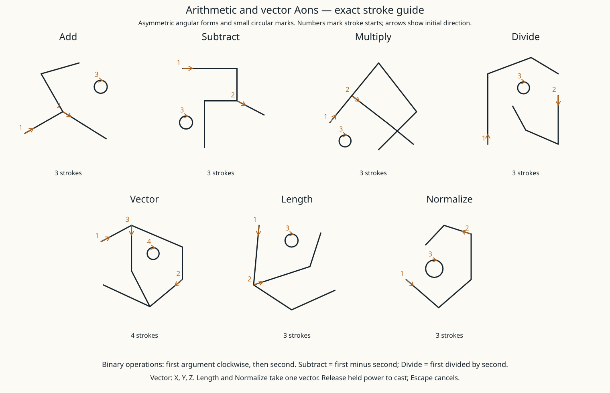

# Arithmetic and vector Aons — 0.58.0-alpha



These seven argument Aons compose with the existing three effects and eight targeting
Aons. Existing shapes and drawn Number0–10 remain. No new typed numeric input.

| Aon | Arguments clockwise from12o'clock | Output |
|---|---|---|
| Add | A, B | Sum or position offset |
| Subtract | A, B | A minus B; two positions yield displacement |
| Multiply | A, B | Product or scaled vector |
| Divide | A, B | A divided by B |
| Vector | Number X, Number Y, Number Z | World-coordinate vector |
| Length | Vector or Direction | Number magnitude |
| Normalize | Vector or Direction | Unit direction |

Vectors use world axes: +X east, +Y up, +Z south. Positions identify places; vectors
identify displacements/directions, so they have different type rules. Directions act
as vectors in arithmetic. Results of vector arithmetic are vectors, not automatically
normalized directions. Use Normalize explicitly when magnitude should be discarded.

| Inputs | Add | Subtract | Multiply | Divide |
|---|---|---|---|---|
| Number, Number | Number | Number | Number | Number |
| Vector, Vector | Vector | Vector | Invalid | Invalid |
| Position, Position | Invalid | Vector | Invalid | Invalid |
| Position, Vector | Position | Position | Invalid | Invalid |
| Vector, Position | Position | Invalid | Invalid | Invalid |
| Vector, Number | Invalid | Invalid | Vector | Vector |
| Number, Vector | Invalid | Invalid | Vector | Invalid |

## Drawing expressions

Use the same relative spacing and optional **Draw Argument** as targeting Aons.
Each operator's direct children are its operands; their order is clockwise from the
parent's center. For binary operators, put the first operand above and the second to
the right for a simple test. For Vector, put X above, Y right and Z below. Use Alt-click
to select a parent; the explicit button can resolve uncertain attachment. Learned
palette placement, undo, white grid, in-air ink and release-to-cast remain unchanged.

Constant calculations appear in recognition feedback (up to three results). They
are also recomputed server-side at casting. World-dependent inputs, such as current
entity positions, are sampled at casting rather than stored when drawn.

## Test spells

Fractional sphere radius:

```text
Heat(Entities In(Sphere(Position Of(Caster), Divide(Number(7), Number(2)))))
```

This thaws freezing entities within3.5blocks of the caster. The two Number glyphs
have7and2surrounding circles; Divide is Sphere's second child, not a third sibling.

Scale your gaze vector:

```text
Force(Caster, Multiply(Look Direction(), Number(2)))
```

This pushes you along your gaze with twice the default vector magnitude. It can also
use Gaze Entity as the target. No argument is silently normalized. Existing strength,
quality and player motion caps still apply.

Place a light above you:

```text
Light(Add(Position Of(Caster), Vector(Number(0), Number(2), Number(0))))
```

This offsets the sampled caster position upward2blocks. Light still needs permitted,
loaded, empty space and uses its existing placement/expiry rules.

Other numeric examples: Add(10,3)=13; Subtract(0,7)=-7; Multiply(7,8)=56; Divide(7,2)=3.5.
These numbers denote drawn Number glyphs, not text entry. Values above10, fractions
and negatives come from expressions. To find a direction from A to B, subtract
Position Of(A) from Position Of(B), then Normalize that vector if desired.

## Errors and limits

- Division by zero, including signed zero, rejects the spell.
- Normalize rejects a zero vector. Vector(0,0,0) itself remains valid and adds no force.
- Invalid operand types, missing inputs, overflow and nonfinite results are errors.
- Calculations preserve their full finite double values; drawing quality affects the
  resulting effect's potency, not the numbers, positions or vector components.
- Expression errors are resolved before effects. World-dependent errors also resolve
  before the first target changes. No partial cast on a failed calculation.
- Math does not raise world-query limits: default casting range8blocks and maximum32
  entity targets of all types still apply. Sphere requires a positive radius within that range.
- Explicit Force vectors default to maximum magnitude8. Larger vectors reject before
  applying force; configure baseEffects.maximumForceVectorMagnitude(.1–64) if needed.
- Existing17glyph/3000point limits remain. No dot/cross products, comparisons, variables,
  loops, persistence, inscriptions or new Dor fuel system in this release.

Protocol42 requires matching clients/server. Light is now stored correctly in empty
chunk sections, has no outline/collision, and is destroyed by pistons rather than
moved away from its expiry tick. New glyph/signature UI also needs the updated client.
