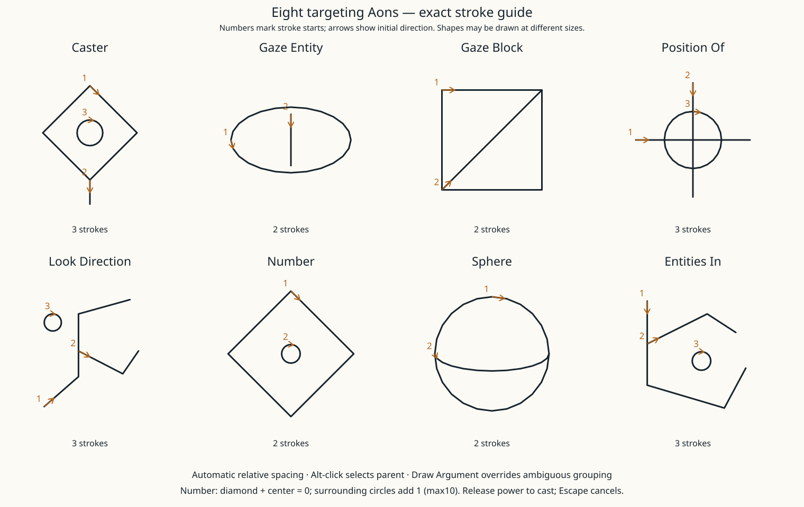

# Targeting Aons (0.57.1-alpha)



Draw the main effect centrally and leave room around it. Draw its first argument
outside its ink bounds, within2.5times its diameter from its center. The band scales
with the parent. Recognized shapes own their strokes; new ink outside their bounds
starts a separate argument. Keep drawing the current argument until it is recognized.
Arguments can have children using the same rule. Faint lines preview attachment.
If two parents fit almost equally, the system rejects the guess.

**Alt-click** an existing Aon to select it. **Draw Argument**, then click the canvas,
explicitly attaches a child to that parent regardless of spacing. This is the fallback
for ambiguity and cramped layouts. With Draw Argument armed, clicking an existing
recognized child reattaches it instead of redrawing (the parent must have been drawn first). Draw Argument does not lock the parent. Undo/Ctrl+Z
reverses strokes/placement/number edits; Remove deletes the selected argument and its
children; Reset clears the spell. Automatic attachment is recomputed when geometry
changes. Explicit parent references survive ordinary edits.

Each parent's direct children are ordered clockwise, starting provisionally at12o'clock.
Nested children evaluate first. Link labels show argument numbers. Selecting an Aon
shows its signature. Number is a diamond with a circle at its center (zero). Each
additional circle around the center adds1, up to10. Keep the circles separate and
inside the diamond; their exact angular placement is flexible. Each circle is a closed
stroke. No typed numbers, negative or decimal literals, or direct values above10.
See the [Number examples](aondor-number-guide.svg). Larger values, fractions and negatives use the [arithmetic Aons](aondor-math-controls.md). Zero is a valid literal, but Sphere
requires a positive radius no greater than configured casting range.

| Aon | Arguments | Result |
|---|---|---|
| Caster | None | Caster entity |
| Gaze Entity | None | Nearest valid entity under gaze, of any type |
| Gaze Block | None | Block under gaze |
| Position Of | Entity or Block | Sampled position |
| Look Direction | Optional Entity; defaults caster | Direction |
| Number | Count of surrounding circles (0–10) | Number |
| Sphere | Position, Number radius | Region |
| Entities In | Region | List of entities of all types, including caster |

Entity selectors include living entities, dropped items, projectiles, XP orbs, vehicles
and other entity types. Removed/dead entities and spectators remain unavailable. Players
and Mobs narrow lists; Exclude and Nearest work with every entity type. Empty gaze selectors and invalid types produce explicit
errors; they never silently revert to the default target.

Main signatures: Light([Position / Entity / Entity list]); Force([Entity or Entity list], [Direction]);
Heat([Entity, Entity list or Block], [Number power=1]). Omitting all arguments preserves existing base
behavior. Explicit Caster can target Force at oneself. Friendly/PvP protections remain
for other entities. No strength/duration/filter glyphs yet; arithmetic and vector operators are documented separately.

Example: Force → Caster (push yourself along your gaze).

Example nested expression:

```text
Heat(Entities In(Sphere(Position Of(Caster), Number(3))))
```

Draw each expression as a separate glyph, with children around their immediate parent.
The optional Draw Argument button is useful for the first nested test. For Sphere,
place Position Of above it and Number to its right so their clockwise order is correct.

Full type checking and recognition happen server-side before effects. Area queries
require loaded chunks and configured casting range; maximumTargets defaults32 (1–128).
No forced terrain generation. Every selected entity must remain in range before the
first effect is applied. Quality uses the weakest glyph's potency; numeric values and
directions are not distorted by imperfect drawing. Shape-only fallback remains75%.
The server cooldown and existing block/other-player protections remain.

Scroll learned Aons, right-click places, mouse distance sizes, left-click confirms.
New targeting Aons must be drawn once to learn their palette entry. Placement uses the
same ownership rules. In-air ink includes the argument drawings, bounded separately
from individual-glyph recognition (128strokes/3000points; active preview capped125
resampled strokes). Release held power to cast; Escape/focus loss/slot change cancel.

Limits:17glyphs total,16strokes/glyph,48points/stroke,3000points total. Protocol41
requires matching clients/server. No variables, arbitrary lists,
other region shapes, item/block inscription or new Dor costs are implemented yet.

Force accepts generic entities and adds motion where their normal physics permits. Heat ignores nonliving entries in mixed lists; it does not destroy or cook dropped items. Gaze Entity has no vanilla pickability filter, so small items/orbs/projectiles are selectable. Walls still occlude gaze; loaded terrain and the initial query target cap still apply.

Heat power, fire, cooking/smelting and optional Skip slots are documented in [Heat controls](aondor-heat-controls.md).

Coordinate Light is permanent; entity Light applies Glowing. See [Light controls](aondor-light-controls.md).
