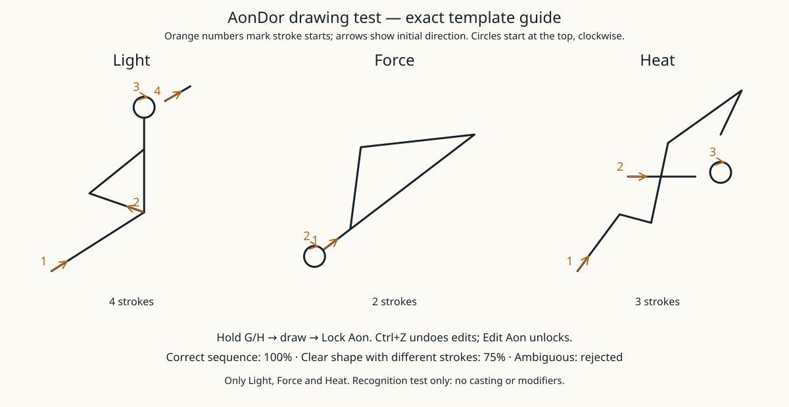

# AonDor template format and base effects

**Light, Force and Heat** are the three main effects. Eight targeting Aons now compose
with them; see [current targeting controls and glyphs](aondor-targeting-controls.md). Their main outlines stay angular,
with small circular marks. Exact shapes and stroke starts/directions:



## Trying the interface

Grant `/attribute <player> cosmerearcanists:aondor_strength base set 1`, then select
AonDor. Hold G (or H in the secondary slot) to open the drawing canvas. Draw with
left mouse, undo with Ctrl+Z, and **release the held power key to cast**. Recognition
updates automatically; recognition never locks the canvas. Escape cancels without
casting. Focus loss, death or slot/dimension change also cancel. The server checks
the finished raw drawing again at cast time. Unknown/ambiguous drawings do nothing.

The canvas fills most of the screen with thin white grid lines. Ink has a soft white
halo and bright core. The in-air projection is visible to tracking players. Scroll
learned Aons for a preview; right-click anchors a template, mouse distance sets size,
left-click confirms, right-click/Escape cancels placement. Unfinished placement is
cancelled on power release; the previously completed drawing is used. Drafts and
learned knowledge remain; no persistent spells or inscriptions are implemented.

## Standalone defaults

- Light: actual level12light in nearby empty air for20seconds; no blocks overwritten.
- Force: pushes the nearest valid gaze target of any entity type within8blocks, adding .45velocity.
- Heat: reduces freezing by140ticks, melts one snow layer or ordinary/frosted ice,
  or lights a dry unlit campfire. No arbitrary fires, damage or cooking.

These defaults are at strength1 with precise recognition. Shape-only matches apply
75%potency by default. Light brightness/duration, Force impulse and thaw amount
scale; discrete block interactions remain one block. Server cooldown20ticks. Typed
nested targeting expressions are available; the three effects retain these defaults
when drawn alone. Fuel and item/block inscription remain future work.

## Defining simplified Aons

Future templates should specify numbered strokes and arrows. Templates
belong in a datapack at:

```text
data/<namespace>/aondor/aons/<name>.json
```

The resource path becomes the Aon's ID. The following is a **format example only**,
not a real or approved Aon; it is deliberately outside runtime resources:

```json
{
  "name": "Format example only",
  "kind": "argument",
  "strokes": [
    [[0.0, 0.0], [1.0, 0.0]],
    [[1.0, 0.0], [1.0, 1.0]]
  ]
}
```

`kind` is `effect` or `argument`. Coordinates are normalized inside the symbol's
own drawing area: x increases rightward, y downward. Array order is stroke order;
point order is drawing direction. Recognition tolerates translation, uniform size
changes and input sample density. Precise recognition preserves stroke order and
direction; shape fallback ignores both and pen lifts. Neither pass auto-rotates
or mirrors the drawing. Aspect ratio is preserved. Ambiguous matches are rejected.

Templates reload with datapacks. Each check is limited to17glyphs (one effect plus
16arguments),16strokes per glyph,48transmitted points per stroke, and3000points total.
The UI resamples completed strokes to24points, preserving order/direction. The server
loads at most256templates. These are implementation limits, not final language rules.

Server settings: `cosmerearcanists-aondor-server.toml`, including enablement,
maximumRecognitionError(default0.12), minimumRecognitionGap(default0.025),
minimumGlyphExtent(default0.01), pathWeight(0.55), endpointWeight(0.25),
cornerWeight(0.1) and relativeStrokeLengthWeight(0.1). Uniform drawing size is
normalized away; relative stroke lengths, endpoints and signed turns help
distinguish similar shapes while retaining order/direction. Known IDs are bounded
to1024per player; at most256active definitions appear in a library snapshot.
Matching client/server protocol40 is required. Sel's acquisition, regional power
attenuation, live effect evaluator, argument types, costs and cross-world behavior
remain unimplemented and must be designed separately.
