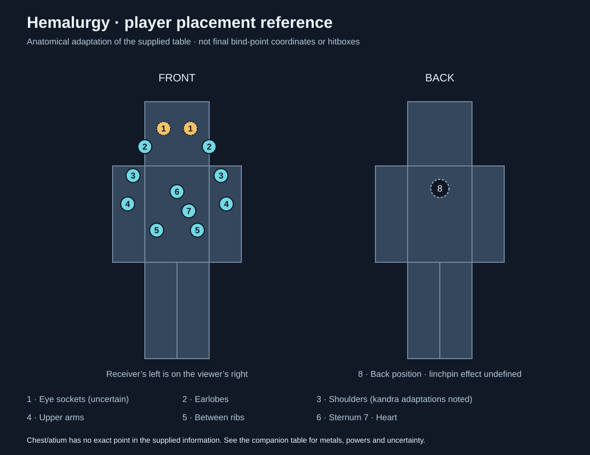

# Hemalurgy placement chart

Compiled from the bind-point information supplied by Ex on 2026-10-23.
The diagram's13marker centers are now the accepted ideal Minecraft bind points,
implemented locally in0.50.0; Minecraft verification is pending. “Confirmed” below means the supplied table states the effect
without an uncertainty qualifier; its numbered references have not been independently
verified here. Ideal positions are recorded below; accuracy radii/curves and some compatibility
assignments remain unspecified.

Numbers identify regions on the drawing. Left/right refer to the receiver;
their left appears on the viewer's right in the front view. Marker placement
adapts anatomy to a block-shaped player and is not a canonical exact bind-point
location. Paired markers identify accepted mod locations, not a requirement for pairs
of spikes or a claim that both sides are canonically interchangeable.

## Position count

The agreed limit is **13 implanted spikes per player**, including the back
position. The layout has two eye sockets, two earlobes, two shoulders, two upper
arms, two intercostal areas, one sternum, one heart and one back position.
The back position supports the linchpin stabilization rule below. Any supported charged spike in this position qualifies as a linchpin. It
provides stabilization AND its stored power; the additional penalty
without a linchpin is50% stronger.

The bilateral layout is a Minecraft adaptation, not a canonical slot count.
Freehand placement within regions, accuracy and compatibility still apply.
The13-spike cap and implantation are implemented locally; engine verification
is pending.

## Accepted body interface and ideal points

Show the player's own Minecraft character, front-facing by default. A button
**below the body** switches between front and back views. Pick up a spike from
the player's inventory onto the normal carried-item cursor (“inventory hand”),
then click a location on the body to implant it. Clicking an installed spike
picks it back up onto that same inventory cursor, like a normal item click.
Use ordinary inventory item conservation; it is a real item transfer, not a
visual copy. Removing a spike this way is real removal with its damage and
lingering penalties. Merely changing views is not removal.

The13diagram marker centers are the actual ideal points for accuracy scoring.
Keep the clicked location for freehand accuracy rather than snapping it to the
ideal center. Stable anatomical point IDs also identify occupancy and residual
penalties. Missing material/power compatibility assignments are still listed
below; accepting locations does not independently confirm uncertain lore.

[Coordinate data](hemalurgy-bind-points.json) records normalized centers for
the implementation: u from left0to right1 **as viewed**, v from head top0to
feet bottom1, inside the diagram's full neutral player silhouette. Front and
back have separate view bounds. Render the actual body at the same neutral
proportions so resizing or a view switch does not alter logical locations.

| Point | View | u | v |
|---|---|---|---|
| Receiver's left eye | Front | 0.604167 | 0.104167 |
| Receiver's right eye | Front | 0.395833 | 0.104167 |
| Left earlobe | Front | 0.750000 | 0.175000 |
| Right earlobe | Front | 0.250000 | 0.175000 |
| Left shoulder | Front | 0.841667 | 0.287500 |
| Right shoulder | Front | 0.158333 | 0.287500 |
| Left upper arm | Front | 0.883333 | 0.397917 |
| Right upper arm | Front | 0.116667 | 0.397917 |
| Left ribs | Front | 0.658333 | 0.500000 |
| Right ribs | Front | 0.341667 | 0.500000 |
| Sternum | Front | 0.500000 | 0.350000 |
| Heart | Front | 0.591667 | 0.425000 |
| Back / linchpin | Back | 0.500000 | 0.337500 |

## Removal damage

| Removed spike | Damage |
|---|---|
| Ordinary spike | 1heart / 2HP |
| Linchpin, with at most4spikes total before removal | 2hearts / 4HP |
| Linchpin, with more than4spikes total before removal | 5hearts / 10HP |

Use the **pre-removal implanted count**, including the linchpin. Thus removing
the linchpin from five implanted spikes deals5hearts even though four remain.
The5-heart branch replaces, rather than adds to, the normal2-heart linchpin
cost. Count only implanted spikes, not lingering wounds or carried inventory.
Removal also starts the existing per-bind-point lingering penalty, without
stacking multiple penalties for that point. Removing the linchpin ends its
stabilization immediately, so >4remaining spikes trigger the usual extra
instability. No new damage on insertion is specified.

The interface and removal damage are implemented locally. Removal uses nominal
magic damage with normal protections and bypasses repeated-hit cooldown evasion.

## Spiritual integrity and the linchpin

Agreed rules:

- Every implanted spike subtracts **25 percentage points** of spiritual integrity,
  including the linchpin itself. This is an additive cost, not25% of the remaining
  integrity. Normal intact baseline is100%.
- Integrity can fall below zero. At a normal baseline:

  | Total implanted spikes | Integrity before any additional linchpin penalty |
  |---|---|
  | 0 | 100% |
  | 1 | 75% |
  | 2 | 50% |
  | 3 | 25% |
  | 4 | 0% |
  | 5 | −25% |
  | 13 | −225% |

- **More than four implanted spikes without a linchpin** makes integrity
  penalties **50% worse (×1.5)**. Interpreted as37.5percentage points per implanted
  spike instead of25 while this condition holds. Five such spikes give
  100−5×37.5=**−87.5%** integrity before other damage or lingering penalties.
  Exactly four does not trigger this extra penalty.
- A linchpin prevents that additional instability penalty. It does not cancel
  the ordinary25-point cost of any spike, restore integrity to100%, or make
  negative integrity safe. It counts toward the13-spike limit.
- Lower and negative integrity make takeover by emotional Allomancers or Shards
  much easier. No automatic death or forced takeover is specified.

A removed spike's negative effects persist for **one Minecraft week** after
removal:7×24,000=**168,000game ticks**, about140minutes (2hours20minutes) at20TPS.
Lingering effects are tracked **per bind point**, not per physical spike or
removal event. Each point contributes at most one spike-related penalty, whether
occupied or still healing. Reinserting a spike at that point does not add its
active cost on top of a residual cost; removing it repeatedly cannot create
multiple residual stacks there. Different bind points can contribute separately.
Freehand coordinate changes within the same point do not create new penalty IDs.

Removing a spike ends its granted powers/benefits immediately; the lingering
penalty grants no power or linchpin stabilization and occupies no implant slot.
Existing spiritual damage and other removed-spike penalties must not be erased
by that removal. A lingering penalty keeps its removal-time cost until expiry, independent of
later linchpin changes. Lingering wounds do not count as implanted spikes for
the “more than four” threshold. Removing again refreshes the same point timer.

The50%-worse interpretation above and immediate loss of benefits were stated in
response to the user's rule. Future Shard takeover mechanics still need defining. No automatic death or unconditional
forced takeover is specified. Existing emotional shielding/resistance rules
are not explicitly removed by this decision.

The runtime now permits negative integrity and integrates spike costs, linchpin
and removal timers. Negative integrity multiplies takeover susceptibility by
1+abs(integrity); existing nonnegative behavior remains. Shard takeover itself
is not implemented. Physical implants and wounds persist through respawn/saves.

## Incompatible placement penalties

Placing a spike in an incompatible bind point—for example, a physical spike
in a temporal point—adds the following stat debuffs for **one Minecraft day**
(**24,000game ticks**, about20minutes at normal20TPS):

| Stat | Reduction | Remaining multiplier |
|---|---|---|
| Maximum health | 25% | 0.75 |
| Attack damage | 25% | 0.75 |
| Movement speed | 25% | 0.75 |
| Vision | 15% | 0.85 |

These are additional to normal spiritual-integrity costs and any applicable
missing-linchpin penalty; wrong placement does not replace the usual spirit
damage. For example,20maximum health becomes15before other modifiers.
An incompatible category is distinct from an imprecise placement within a
compatible region: the latter remains governed by the accepted accuracy rule.

Per-point anti-stacking is enforced. Repeated mistakes refresh that point's
timer; stat reductions apply once while any mistake timer remains active.
Vision reduces the sight attribute and camera FOV. The one-day mistake timer
is distinct from the seven-day lingering spiritual penalty after removal.
These runtime defaults are implemented locally but engine-unverified.

## Supplied bindings

A = Allomancy; F = Feruchemy. A spike holds one selected effect, not all powers
listed for a region. Existing extraction rules still determine its contents.

| Region | Bind point | Spike | Effect in supplied information | Evidence/status | Seen in / supplied references |
|---|---|---|---|---|---|
| 8 · Back | Interscapular space, between shoulder blades | Varies; linchpin spike | Unknown exact effect; binds other spikes together to keep receiver alive | Reference only; no material rule or survival mechanic defined | Normal Inquisitors [108] |
| 1 · Face | Left orbit / eye socket | Steel | Likely A:steel and/or A:iron | Unconfirmed; do not present as an established assignment | Normal Inquisitors [108] |
| 1 · Face | Right orbit / eye socket | Steel | Likely A:steel and/or A:iron | Unconfirmed; do not present as an established assignment | Normal Inquisitors [108]; Kelsier [109] |
| 5 · Ribs | Intercostal space / between ribs | Steel | Likely A:pewter and/or A:tin | Unconfirmed | Normal Inquisitors [108] |
| 5 · Ribs | Intercostal space | Bronze | A:brass, A:zinc, A:copper or A:bronze | Stated effect; each charged spike supplies one power | Normal Inquisitors [108] |
| 5 · Ribs | Intercostal space | Electrum | A:duralumin | Stated specific power; does not establish every electrum-category power here | Wax [110] |
| 5 · Ribs | Intercostal space | Gold | F:gold | Stated specific power | Normal Inquisitors [111] |
| Broad chest, no exact marker | Chest | Atium | A:atium | Reference only; new atium spike behavior is outside agreed scope | Normal Inquisitors [113]; chest reference [112] |
| 7 · Chest | Heart | Pewter | F:steel | Stated specific power | Inquisitor at Vetitan [108] |
| 7 · Chest | Heart | Bronze | A:copper | Stated specific power | Penrod [36] |
| 6 · Chest | Sternum / breastbone | Steel | A:steel | Stated specific power | Zane [114][115] |
| 2 · Head | Earlobe | Bronze | A:bronze | Stated specific power; side unspecified | Vin [116] |
| 4 · Arm | Upper arm | Bronze | A:bronze | Stated specific power; side unspecified | Quellion [117] |
| 3 · Shoulder | Shoulders | Steel | A:pewter | Stated specific power | Spook [118] |
| 3 · Shoulder | Shoulders | Iron | Blessing of Potency | Kandra example; proposed player adaptation: stored attack-damage bonus | Kandra; supplied note: shoulders are not anatomically consistent |
| 3 · Shoulder | Shoulders | Tin | Blessing of Awareness | Kandra example; proposed player adaptation: stored sight/hearing/touch bonuses | Kandra; same anatomical caveat |
| 3 · Shoulder | Shoulders | Copper | Blessing of Presence | Kandra example; proposed player adaptation: stored resistance and memory-capacity bonuses | Kandra; same anatomical caveat |
| 3 · Shoulder | Shoulders | Zinc | Blessing of Stability | Kandra example; proposed player adaptation: stored emotional resistance | Kandra; same anatomical caveat |

## Accepted player bindings

These are accepted Minecraft rules. Both eyes accept A:steel and A:iron.
Source uncertainty and kandra-to-player adaptations remain labeled as evidence
limitations; they do not make the accepted game mappings uncertain.

| Spike contents | Accepted compatible region(s) | Basis |
|---|---|---|
| Steel → A:steel | Sternum or either eye socket | User explicitly accepts both eyes; source eye mapping unconfirmed |
| Steel → A:iron | Either eye socket | User explicitly accepts both eyes; source mapping unconfirmed |
| Steel → A:pewter | Shoulders or between ribs | Shoulders stated; ribs uncertain |
| Steel → A:tin | Between ribs | Unconfirmed source mapping |
| Bronze → A:brass or A:zinc | Between ribs | Stated |
| Bronze → A:copper | Between ribs or heart | Stated |
| Bronze → A:bronze | Between ribs, earlobe or upper arm | Stated |
| Electrum → A:duralumin | Between ribs | Stated |
| Gold → F:gold | Between ribs | Stated |
| Pewter → F:steel | Heart | Stated |
| Iron → strength | Shoulders | Accepted player adaptation of Potency |
| Tin → senses | Shoulders | Accepted player adaptation of Awareness |
| Copper → resistance and memory | Shoulders | Accepted player adaptation of Presence |
| Zinc → emotional resistance | Shoulders | Accepted player adaptation of Stability |

## Source gaps covered by accepted game rules

The supplied information did **not** assign bind points for these contents;
the additional game mappings below are now accepted:

- Pewter: F:iron, F:tin, F:pewter.
- Brass: F:zinc, F:brass, F:copper, F:bronze.
- Cadmium: A:gold, A:electrum, A:cadmium, A:bendalloy, the mod's A:atium alloy.
- Gold: F:electrum, F:cadmium, F:bendalloy.
- Electrum: A:aluminum, A:chromium, A:nicrosil.
- Bendalloy: F:aluminum, F:duralumin, F:chromium, F:nicrosil.
- Duralumin: stolen Connection and Identity.

Aluminum's lethal-hit suppression needs no implantation bind point: it leaves
no charge. Chromium, nicrosil, lead, silver and nickel spikes remain intentionally
unimplemented; mentioning their powers as contents of other supported metals
does not add Hemalurgic behavior to those spike materials. Atium and linchpin
entries above do not expand the agreed implementation scope.

For the implemented freehand menu, the existing accepted design remains: show the
player's character, let the user choose placement, make proximity to a compatible
ideal point determine effectiveness, and apply additional negative effects for
incompatible placements. This compilation does not invent missing locations,
make eye/rib guesses certain, or choose placement radii, blindness or automatic death
without a linchpin. The accepted cap and stability rules are recorded above.

## Accepted additional bindings and linchpin rule

Ex accepted these recommendations after clarifying that A:steel and A:iron
can both go in either eye. These rules are implemented locally; Minecraft verification is pending.

1. Linchpin: any supported, charged spike placed in the back point can stabilize
   the others. In that position it provides stabilization AND its original
   stored power; it still counts toward13and costs25integrity points.
2. The additional compatibility assignments are as follows, preserving
   the existing chart's more specific bindings:

   | Previously unassigned contents | Accepted region |
   |---|---|
   | Pewter: F:iron, F:tin, F:pewter | Shoulders |
   | Brass: F:zinc, F:brass, F:copper, F:bronze | Upper arms |
   | Cadmium: all implemented contents | Between ribs |
   | Gold: F:electrum, F:cadmium, F:bendalloy | Between ribs |
   | Electrum: A:aluminum, A:chromium, A:nicrosil | Between ribs |
   | Bendalloy: all implemented contents | Sternum |
   | Duralumin: Connection and Identity | Heart |

These additional assignments are Minecraft balance rules, not newly established
lore. No additional spike materials or powers are added. Accuracy tuning, timer
refresh policy, visual presentation and other routine implementation choices can
use documented configurable defaults; they need not each block implementation.

## Current implementation status

See README0.50.0for controls, access, persistence, configuration, seed/currency
and verification details. K opens the native inventory-cursor body menu after
an actual Scadrial visit or with active stolen Scadrial Connection. A charged
Scadrial Connection spike permits a restricted bootstrap/repair view until it
is active. The accepted JSON mirrors production constants; validation checks
both coordinates and every positive/negative compatibility assignment.
